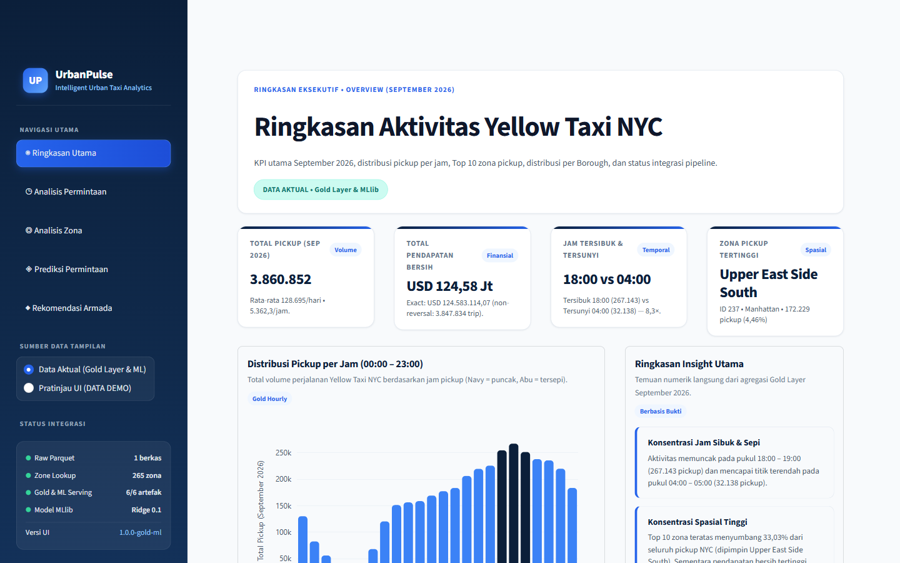

# UrbanPulse — Intelligent Urban Taxi Analytics (`_024`)

Proyek analitik **Big Data & Machine Learning** end-to-end untuk menganalisis pola permintaan spasial-temporal serta memprediksi kebutuhan layanan **Yellow Taxi di New York City (NYC)** menggunakan data nyata **NYC Taxi and Limousine Commission (TLC)** periode September 2026 (`3.876.044` rekaman mentah).

UrbanPulse mengintegrasikan **Apache NiFi**, **Hadoop HDFS**, **PySpark**, **Spark MLlib**, dan **Streamlit + Plotly** dalam arsitektur **Medallion** (*Raw → Silver → Gold → ML → Serving Layer → Interactive Dashboard*).

---

## Ringkasan Hasil Utama

| Tahap / Metrik | Hasil Tervalidasi |
| :--- | :--- |
| **Data Ingestion (Apache NiFi 1.28.1)** | Flow `urbanpulse_ingestion_024` (`ListFile → FetchFile → UpdateAttribute → PutHDFS → LogAttribute`) terverifikasi 100% cocok byte & SHA-256 (`67.374.896` B) pada uji terisolasi HDFS |
| **Raw Layer (Hadoop HDFS 3.5.0)** | `3.876.044` baris, `21` kolom asli NYC TLC (*read-only*, immutable) |
| **Silver Layer v2 (`clean_yellow_taxi_024.py`)** | `3.860.852` baris valid (`99,61%` retensi), `49` kolom (`21` asli + `28` turunan `_024`), deteksi `13.018` *reversal pairs* |
| **Gold Layer (`build_gold_layer_024.py`)** | `5` dataset Parquet terverifikasi `100%` rekonsiliasi & *zero-leakage*, termasuk panel fitur ML `187.920` baris (`261` zona × `720` jam) |
| **Model ML Terpilih (`ridge_reg_0p1_024`)** | Spark MLlib Ridge Regression (`regParam=0.1`) — Test Holdout (`24–30 Sep 2026`, `43.848` baris): **RMSE `12,2597`** (`-19,28%` vs Naive `lag_168h`), **MAE `4,5495`**, **$R^2$ `0,9564`**, **WAPE `21,36%`** |
| **Segmen Operasional Top-50 Zona (91% Volume)** | **MAE `17,4498`**, **RMSE `27,4563`** (`-19,50%` vs Naive), **$R^2$ `0,9244`**, **WAPE `17,25%`** (`45/50` zona unggul atas Naive) |
| **Dashboard Interaktif (`v1.0.0-gold-ml`)** | `5` halaman analitik interaktif + `8` rekomendasi alokasi armada berbasis bukti aktual + mode `DATA DEMO` bawaan |

---

## Arsitektur Sistem End-to-End

```text
[NYC TLC Yellow Taxi Parquet — Sep 2026 (64.3 MiB, 3.87M baris)]
                             │
                             ▼
   [Apache NiFi 1.28.1 — urbanpulse_ingestion_024]
   ListFile → FetchFile (non-destructive) → UpdateAttribute → PutHDFS → LogAttribute
                             │
                             ▼
   [Hadoop HDFS 3.5.0 — Raw Layer (Immutable)]
   /urbanpulse_024/raw/yellow_taxi/
                             │
                             ▼
   [PySpark 4.0.4 — Silver Layer v2 (clean_yellow_taxi_024.py)]
   /urbanpulse_024/processed/yellow_taxi_024/  (3,860,852 baris, 49 kolom)
                             │
                             ▼
   [PySpark 4.0.4 — Gold Layer (build_gold_layer_024.py)]
   /urbanpulse_024/analytics/  (5 dataset Parquet: hourly, zone, temporal, zone_hourly, features)
                             │
                             ▼
   [Spark MLlib 4.0.4 — Training & Evaluation]
   train_demand_model_024.py → evaluate_demand_model_024.py (Ridge 0.1, zero-leakage)
                             │
                             ▼
   [Serving Layer (data/analytics/) + Zone Lookup (data/reference/taxi_zone_lookup_024.csv)]
                             │
                             ▼
   [Streamlit + Plotly Dashboard — dashboard/app_024.py (http://localhost:8501)]
```

Dokumentasi arsitektur lengkap tersedia di:
- [docs/technical_documentation_024.md](docs/technical_documentation_024.md)
- [docs/methodology_024.md](docs/methodology_024.md)
- [docs/nifi_setup_024.md](docs/nifi_setup_024.md)
- [docs/dashboard_architecture_024.md](docs/dashboard_architecture_024.md)

---

## Fitur Utama Dashboard

Aplikasi dashboard (`UrbanPulseDashboard_024`) menyediakan **5 halaman utama** interaktif:

1. **Ringkasan Utama (`dashboard/pages/overview_024.py`):** KPI bulanan, distribusi permintaan 24 jam, Top-10 zona pickup, pangsa per Borough, dan ringkasan insight berbasis bukti.
2. **Analisis Permintaan (`dashboard/pages/demand_analysis_024.py`):** Filter tanggal, hari kerja vs akhir pekan, blok waktu, tren harian, dan heatmap pola permintaan `7 hari × 24 jam`.
3. **Analisis Zona (`dashboard/pages/zone_analysis_024.py`):** Peringkat zona pickup & pendapatan bersih, filter Borough & `service_zone`, perbandingan Demand vs Revenue, dan dukungan opsional GeoJSON choropleth.
4. **Prediksi Permintaan (`dashboard/pages/demand_prediction_024.py`):** Evaluasi *out-of-sample* model Ridge Regression pada *Locked Test Holdout* (`24–30 Sep 2026`), toggle metrik `All 261 Zones` vs `Top 50 Operational Zones`, kurva Aktual vs Prediksi + interval estimasi + Baseline Naive (`lag_168h`).
5. **Rekomendasi Armada (`dashboard/pages/recommendations_024.py`):** Rekomendasi alokasi armada berbasis bukti aktual Gold Layer & evaluasi error per zona (diturunkan dinamis oleh `build_evidence_recommendations_024()`).

### Pratinjau Antarmuka Dashboard



> Tangkapan layar halaman lain (`dashboard_02`–`05`) serta bukti alur Apache NiFi (`nifi_01`–`04`) tersedia di direktori [`reports/figures/`](reports/figures/).

---

## Teknologi yang Digunakan

| Lapisan | Teknologi | Peran |
| :--- | :--- | :--- |
| **Data Ingestion** | Apache NiFi `1.28.1` | Otomatisasi ingestion file Parquet lokal ke HDFS tanpa menghapus file sumber |
| **Distributed Storage** | Apache Hadoop HDFS `3.5.0` | Penyimpanan terdistribusi untuk Raw, Silver, dan Gold Layer |
| **Big Data Processing** | Apache Spark / PySpark `4.0.4` | Validasi data mentah, cleaning Silver v2, dan agregasi Gold Layer + fitur lag/rolling |
| **Machine Learning** | Spark MLlib `4.0.4` | Pelatihan, seleksi kronologis (`Ridge`, `Random Forest`, `GBT` vs `Naive lag_168h`), dan evaluasi tersegmentasi |
| **Dashboard & Visualisasi** | Streamlit, Plotly, Pandas, PyArrow, NumPy | Antarmuka analitik interaktif 5 halaman berbasis serving layer |

---

## Struktur Direktori

```text
urbanpulse-big-data-analytic_024/
├── README.md                                  # Panduan utama proyek (file ini)
├── PROJECT_BRIEF_024.md                       # Konteks, ruang lingkup, dan roadmap proyek
├── requirements.txt                           # Dependensi Python untuk dashboard (+ catatan PySpark)
├── .gitignore                                 # Pengecualian dataset besar, model biner, .venv, cache, & rahasia
├── .streamlit/
│   └── config.toml                            # Konfigurasi tema dan server Streamlit
├── nifi/
│   ├── flows/
│   │   └── urbanpulse_ingestion_024.json      # Ekspor resmi Process Group Apache NiFi
│   └── configs/
│       ├── hdfs_connection_024.properties     # Referensi parameter koneksi NiFi → HDFS
│       ├── nifi_runtime_024.properties        # Ringkasan konfigurasi runtime NiFi 1.28.1
│       └── ingestion_test_result_024.json     # Log hasil verifikasi uji ingestion NiFi
├── spark/
│   └── processing/
│       ├── validate_raw_yellow_taxi_024.py    # Profiling & validasi skema Raw Layer
│       ├── audit_silver_cleaning_impact_024.py# Audit dampak aturan cleaning & deteksi reversal pairs
│       ├── clean_yellow_taxi_024.py           # Pemrosesan Raw → Silver Layer v2
│       └── build_gold_layer_024.py            # Pembuatan 5 dataset Gold Layer & panel fitur ML
├── ml/
│   ├── training/
│   │   └── train_demand_model_024.py          # Pelatihan & seleksi model Spark MLlib (chronological split)
│   ├── evaluation/
│   │   └── evaluate_demand_model_024.py       # Evaluasi tersegmentasi & uji reproduksibilitas model
│   └── models/
│       └── training_run_metadata_024.json     # Metadata audit hasil training (artefak biner di-ignore)
├── dashboard/
│   ├── app_024.py                             # Entry point aplikasi Streamlit (UrbanPulseDashboard_024)
│   ├── config_024.py                          # Konstanta direktori, palet warna, & kontrak serving layer
│   ├── data_loader_024.py                     # Pembaca data serving layer & pembangun rekomendasi bukti
│   ├── demo_data_024.py                       # Penyedia DATA DEMO berlabel eksplisit untuk pratinjau UI
│   ├── components_024.py                      # Komponen UI reusable (KPI card, header, banner, empty state)
│   ├── charts_024.py                          # Builder grafik interaktif Plotly
│   ├── assets/
│   │   └── styles_024.css                     # Stylesheet kustom UrbanPulse
│   └── pages/
│       ├── overview_024.py                    # Halaman 1: Ringkasan Utama
│       ├── demand_analysis_024.py             # Halaman 2: Analisis Permintaan
│       ├── zone_analysis_024.py               # Halaman 3: Analisis Zona
│       ├── demand_prediction_024.py           # Halaman 4: Prediksi Permintaan (ML)
│       └── recommendations_024.py             # Halaman 5: Rekomendasi Armada
├── data/
│   ├── raw/                                   # Dataset mentah Parquet (dikecualikan dari Git)
│   ├── reference/
│   │   └── taxi_zone_lookup_024.csv           # Tabel lookup resmi 265 zona NYC TLC (12 KB)
│   ├── processed/                             # Silver Layer lokal jika diekspor (dikecualikan dari Git)
│   └── analytics/                             # Serving Layer Gold & prediksi ML (Parquet dikecualikan dari Git)
├── reports/
│   ├── *_024.md & *_024.json                  # Laporan & ringkasan audit Raw, Silver, Gold, & Evaluasi ML
│   └── figures/                               # Tangkapan layar autentik dashboard & Apache NiFi
└── docs/
    ├── technical_documentation_024.md         # Dokumentasi teknis arsitektur & runtime end-to-end
    ├── methodology_024.md                     # Metodologi pembersihan data, fitur ML, & evaluasi
    ├── nifi_setup_024.md                      # Panduan setup & verifikasi Apache NiFi 1.28.1
    ├── dashboard_architecture_024.md          # Arsitektur UI & kontrak skema data/analytics/
    ├── naming_convention_024.md               # Konvensi penamaan _024 & provenance dataset
    ├── development_log_024.md                 # Log pengembangan bertahap Progress 1–6
    ├── testing_log_024.md                     # Log pengujian & hasil verifikasi sistem
    └── evidence_checklist_024.md              # Daftar bukti artefak & integritas pipeline
```

---

## Instalasi & Konfigurasi

### 1. Prasyarat

- **Menjalankan Dashboard (Lokal / Demo / Serving Layer):**
  - Python `3.10+` (dikembangkan & diuji pada Python `3.12`)
  - `pip` dan `venv`
- **Menjalankan Pipeline Big Data & ML (Opsional — Reproduksi Penuh):**
  - Linux / WSL2 Ubuntu `24.04` dengan OpenJDK `17`
  - Apache Hadoop HDFS `3.5.0` (`hdfs://localhost:9000`)
  - Apache Spark `4.0.4` (PySpark & Spark MLlib)
  - Apache NiFi `1.28.1` (standalone, port `8090`, lihat [docs/nifi_setup_024.md](docs/nifi_setup_024.md))

### 2. Clone Repository & Instal Dependensi Dashboard

```bash
git clone https://github.com/putrianastasyaa/urbanpulse-big-data-analytic_024.git
cd urbanpulse-big-data-analytic_024
```

**Windows (PowerShell):**

```powershell
python -m venv .venv
.\.venv\Scripts\Activate.ps1
pip install -r requirements.txt
```

**Linux / macOS / WSL:**

```bash
python3 -m venv .venv
source .venv/bin/activate
pip install -r requirements.txt
```

### 3. Konfigurasi

- **Streamlit:** Konfigurasi tema, navigasi, dan server sudah tersedia di [`.streamlit/config.toml`](.streamlit/config.toml).
- **Apache NiFi & HDFS:** Sesuaikan path lokal pada [`nifi/configs/hdfs_connection_024.properties`](nifi/configs/hdfs_connection_024.properties) dan [`nifi/flows/urbanpulse_ingestion_024.json`](nifi/flows/urbanpulse_ingestion_024.json) apabila mengimpor flow pada direktori workspace atau cluster Hadoop berbeda.
- **Dataset Mentah (Tidak Disertakan di Git):** Unduh dataset resmi **NYC TLC Yellow Taxi Trip Records** (`yellow_tripdata_2026-09.parquet`) dari portal [NYC TLC Trip Record Data](https://www.nyc.gov/site/tlc/about/tlc-trip-record-data.page), lalu simpan sebagai `data/raw/yellow_tripdata_2026-09_024.parquet` (lihat provenance & SHA-256 di [docs/naming_convention_024.md](docs/naming_convention_024.md)).

---

## Cara Menjalankan Dashboard

Jalankan perintah berikut dari direktori root repositori:

```powershell
streamlit run dashboard/app_024.py
```

Atau secara langsung menggunakan executable virtual environment di Windows:

```powershell
.\.venv\Scripts\streamlit.exe run dashboard/app_024.py
```

Buka browser pada alamat lokal:

- `http://localhost:8501`

### Mode Sumber Data pada Sidebar Dashboard

1. **`Data Aktual (Gold Layer & ML)`** *(Default)*: Membaca artefak serving layer di `data/analytics/` (`gold_hourly_demand_024`, `gold_zone_demand_024`, `gold_temporal_patterns_024`, `gold_zone_hourly_demand_024`, `demand_predictions_024.parquet`, `model_metrics_024.json`) serta `data/reference/taxi_zone_lookup_024.csv`. Jika artefak Parquet belum dibuat di mesin lokal, dashboard menampilkan *empty state* yang informatif tanpa mengarang angka.
2. **`Pratinjau UI (DATA DEMO)`**: Dapat langsung dijalankan setelah `git clone` tanpa perlu menjalankan HDFS/Spark, menampilkan simulasi berlabel **DATA DEMO** secara eksplisit untuk mengeksplorasi seluruh 5 halaman, grafik Plotly, heatmap, filter interaktif, dan kartu rekomendasi.

---

## Menjalankan Pipeline Big Data & ML (Referensi)

Apabila seluruh infrastruktur Hadoop HDFS (`hdfs://localhost:9000`) dan Apache Spark (`4.0.4`) aktif di Linux/WSL2, urutan eksekusi pipeline adalah:

```bash
# 1. Ingestion ke HDFS (via Apache NiFi flow urbanpulse_ingestion_024.json atau hdfs dfs -put)
# 2. Validasi Raw Layer (read-only)
spark-submit --master local[*] spark/processing/validate_raw_yellow_taxi_024.py

# 3. Audit dampak cleaning & pembangunan Silver Layer v2
spark-submit --master local[*] spark/processing/audit_silver_cleaning_impact_024.py
spark-submit --master local[*] spark/processing/clean_yellow_taxi_024.py

# 4. Pembangunan 5 dataset Gold Layer & panel fitur ML
spark-submit --master local[*] spark/processing/build_gold_layer_024.py

# 5. Pelatihan, seleksi model, dan evaluasi Spark MLlib
spark-submit --master local[*] ml/training/train_demand_model_024.py
spark-submit --master local[*] ml/evaluation/evaluate_demand_model_024.py
```

Untuk menyajikan hasil Gold Layer ke dashboard lokal, salin 4 tabel Gold BI dari HDFS ke `data/analytics/` menggunakan `hdfs dfs -get` (sementara `demand_predictions_024.parquet` dan `model_metrics_024.json` ditulis langsung oleh script ML). Detail lengkap tersedia di [docs/technical_documentation_024.md](docs/technical_documentation_024.md).

---

## Konvensi Penamaan (`_024`)

Seluruh file, class, fungsi, variabel, kolom turunan, tabel, model, dan artefak buatan proyek menggunakan akhiran **`_024`** sesuai [docs/naming_convention_024.md](docs/naming_convention_024.md). Pengecualian berlaku untuk:
- Nama kolom asli NYC TLC & Zone Lookup (`PULocationID`, `tpep_pickup_datetime`, `Zone`, `Borough`, `service_zone`, dll.).
- Identifier/API bawaan library dan framework (PySpark, Spark MLlib, Streamlit, Plotly, Pandas, Apache NiFi).
- File standar tooling (`README.md`, `.gitignore`, `.gitkeep`, `requirements.txt`, `.streamlit/config.toml`).

---

## Catatan Keamanan & Kebijakan Ukuran Repositori

Demi menjaga keamanan dan ukuran repositori tetap ringan, aset berikut **sengaja dikecualikan** melalui [`.gitignore`](.gitignore):
- Dataset mentah Parquet (`data/raw/*.parquet`, ~64,3 MiB) dan data hasil pemrosesan Parquet (`data/processed/`, `data/analytics/`).
- Artefak biner model Spark MLlib (`ml/models/ridge_reg_0p1_024/`) beserta file checksum `*.crc`.
- Virtual environment Python (`.venv/`), cache (`__pycache__/`), serta file sementara/log (`*.log`, `*.tmp`, `~$*`).
- Dokumen referensi eksternal (`references/*.pdf`), backup dokumentasi lama (`docs/backup_progress_*/`), dan berkas deliverable Office biner (`reports/final_024/`).
- Seluruh file rahasia/kredensial (`.env`, `.streamlit/secrets.toml`, `*.pem`, `*.key`).
