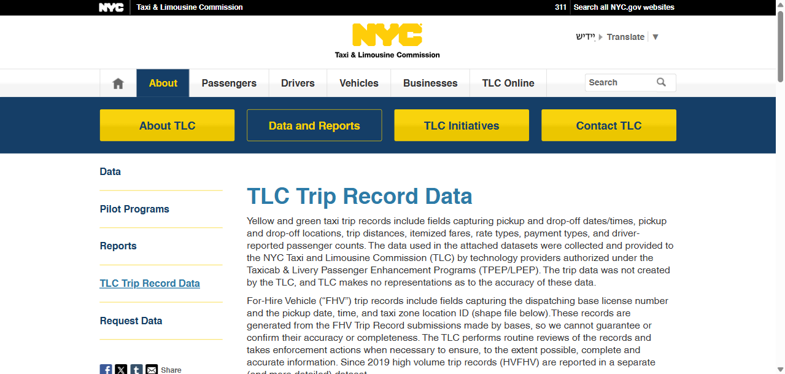

# Development Log — UrbanPulse: Intelligent Urban Taxi Analytics (`_024`)

> **Proyek:** UrbanPulse — Intelligent Urban Taxi Analytics  
> **Root Workspace:** `D:\A University\Big Data dan Analitik\Project Akhir`  
> **Tanggal Pembaruan Log:** 25 November 2026  
> **Cakupan Dokumentasi:** Progress 1 s.d. Progress 6 (seluruh fase implementasi teknis selesai dan terverifikasi; disertai inventaris jujur sisa bukti screenshot CLI & finalisasi laporan PDF)  
> **Prinsip Dokumentasi:** Berbasis bukti aktual artefak proyek. Informasi historis yang tidak tersimpan sebagai log ditandai `[PERLU DILENGKAPI]`, dan bukti visual yang belum diambil ditandai `[PERLU DIAMBIL]`.

---

## Ringkasan Status Seluruh Progress

| Progress | Nama Tahap | Status Aktual (25 Nov 2026) | Artefak & Laporan Utama |
| :-: | :--- | :---: | :--- |
| **Progress 1** | Infrastruktur dan Environment | **SELESAI** *(Inti Big Data, UI Scaffold, & NiFi selesai pada P6; Git belum diinisialisasi)* | [PROJECT_BRIEF_024.md](../PROJECT_BRIEF_024.md), [naming_convention_024.md](naming_convention_024.md) |
| **Progress 2** | Data Ingestion, Raw Validation, dan Silver Layer | **SELESAI** *(Sep 2026; Silver v2 Live & Terverifikasi)* | [raw_validation_report_024.md](../reports/raw_validation_report_024.md), [silver_cleaning_impact_audit_024.md](../reports/silver_cleaning_impact_audit_024.md), [silver_cleaning_report_024.md](../reports/silver_cleaning_report_024.md) |
| **Progress 3** | Gold Layer dan Analytical Dataset | **SELESAI DI HDFS** *(5 dataset Parquet live, 0-leakage verified, Zone Lookup tervalidasi)* | [gold_layer_report_024.md](../reports/gold_layer_report_024.md), [gold_layer_summary_024.json](../reports/gold_layer_summary_024.json), [zone_lookup_validation_024.md](../reports/zone_lookup_validation_024.md) |
| **Progress 4** | Machine Learning Readiness Audit | **SELESAI** *(Audit populasi 144.072 baris, split kronologis, & benchmark naif selesai)* | [ml_readiness_and_plan_024.md](../reports/ml_readiness_and_plan_024.md), [ml_readiness_audit_024.json](../reports/ml_readiness_audit_024.json) |
| **Progress 5** | ML Training, Evaluasi, Serving Layer, & Dashboard Data Aktual | **SELESAI** *(Ridge `0.1` terpilih & tervalidasi; 6/6 artefak `data/analytics/`; Dashboard `1.0.0-gold-ml` aktif dengan 5 screenshot asli)* | [ml_evaluation_report_024.md](../reports/ml_evaluation_report_024.md), [ml_evaluation_summary_024.json](../reports/ml_evaluation_summary_024.json), `ml/models/ridge_reg_0p1_024/`, `dashboard/app_024.py`, `reports/figures/dashboard_01..05_*_024.png` |
| **Progress 6** | Integrasi Aman Apache NiFi (`1.28.1`) → HDFS | **SELESAI** *(Flow `urbanpulse_ingestion_024` terverifikasi di `/urbanpulse_024/nifi_test_024/` dengan SHA-256 100% identik; file Raw produksi tidak ditimpa)* | [nifi_setup_024.md](nifi_setup_024.md), [urbanpulse_ingestion_024.json](../nifi/flows/urbanpulse_ingestion_024.json), [ingestion_test_result_024.json](../nifi/configs/ingestion_test_result_024.json), `reports/figures/nifi_01..04_*_024.png` |

*(Catatan status deliverable akhir: seluruh lapisan teknis pipeline — NiFi test ingestion, HDFS Raw/Silver/Gold, Spark MLlib, Serving Layer, dan Dashboard Streamlit 5 halaman — telah berfungsi dan terverifikasi. Laporan Akhir DOCX/PDF dan Slide Presentasi PPTX telah selesai disusun di `reports/final_024/` dengan 10 screenshot autentik browser + 1 diagram arsitektur ilustratif serta tabel native tanpa gambar sintetis; inisialisasi Git/GitHub bersifat opsional.)*

---

## PROGRESS 1 — Infrastruktur dan Environment

- **Rentang Waktu Aktual:** `2026-11-24 23:10 WIB` s.d. `2026-11-25 06:53 WIB` *(berdasarkan timestamp file artefak di workspace; waktu instalasi awal Java/Hadoop/Spark di WSL sebelum audit: `[PERLU DILENGKAPI]`)*
- **Status:** **SELESAI** untuk infrastruktur inti Big Data lokal dan scaffold UI; **BELUM** untuk Apache NiFi dan inisialisasi repositori Git.

### 1.1 Tujuan Progress
1. Menyiapkan workspace proyek yang terstruktur rapi per lapisan arsitektur Big Data dan menetapkan konvensi penamaan wajib `_024`.
2. Mengaudit serta memverifikasi perangkat host Windows 11, WSL2 Ubuntu 24.04.4 LTS, OpenJDK 17, Hadoop 3.5.0 (HDFS pseudo-distributed), dan Apache Spark 4.0.4 (PySpark).
3. Memetakan kendala sumber daya dan konfigurasi environment beserta solusi mitigasinya sebelum pemrosesan data jutaan baris.
4. Menyiapkan virtual environment Python (`.venv`) dan kerangka awal dashboard Streamlit + Plotly.

### 1.2 Konfigurasi yang Sudah Diterapkan vs Rencana

| Komponen | Status | Detail Aktual / Rencana |
| :--- | :---: | :--- |
| **Workspace & Struktur Folder** | **Sudah Diterapkan** | Root `D:\A University\Big Data dan Analitik\Project Akhir` dengan pemisahan `data/`, `spark/`, `ml/`, `nifi/`, `dashboard/`, `reports/`, `docs/`, `references/`, `scripts/`. |
| **Host Windows 11** | **Sudah Diterapkan** | Windows 11 Home Single Language (Build 26200, 64-bit), CPU Intel Core i7-1355U (10 cores, 12 threads), RAM 16 GB (~15.55 GiB), Disk `C:\` (17.42 GB kosong), `D:\` (55.86 GB kosong), `E:\` (255.85 GB kosong). |
| **WSL2 Ubuntu** | **Sudah Diterapkan** | Distribusi default `Ubuntu 24.04.4 LTS (Noble)`, WSL2 aktif, `systemd` aktif, alokasi default RAM `7.5 GiB` + Swap `2.0 GiB`, `ssh.socket` aktif di port 22. |
| **Java OpenJDK 17** | **Sudah Diterapkan** | OpenJDK `17.0.20` pada `/usr/lib/jvm/java-17-openjdk-amd64`, dikonfigurasi di `~/.bashrc`. |
| **Apache Hadoop 3.5.0 & HDFS** | **Sudah Diterapkan** | Terpasang di `/usr/local/hadoop`, mode pseudo-distributed (`hdfs://localhost:9000`, `dfs.replication=1`, data dir `/home/ubuntu/hadoopdata`), hierarki proyek `/urbanpulse_024/{raw,processed,analytics}/` aktif. |
| **Apache Spark 4.0.4 (PySpark)** | **Sudah Diterapkan** | Terpasang di `/usr/local/spark` (build `hadoop3`, Scala `2.13.16`, Python `3.12.3`), dijalankan dalam mode `--master local[*]` membaca/menulis langsung ke `hdfs://localhost:9000`. |
| **Python Dashboard Env (`.venv`)** | **Sudah Diterapkan** | Virtual environment Windows dengan `streamlit>=1.50.0`, `plotly>=5.22.0`, `pandas>=2.2.0`, `pyarrow>=17.0.0`, `numpy>=1.26.0` (`requirements.txt`). |
| **Apache NiFi** | **Selesai (Progress 6)** | Pada Progress 1 sempat ditunda; pada Progress 6 telah dipasang secara standalone terisolasi (**Apache NiFi `1.28.1`** pada OpenJDK 17 di `/home/ubuntu/nifi-1.28.1`, UI `http://127.0.0.1:8090/nifi`). |
| **Git & GitHub Repository** | **Rencana (Belum)** | `.gitignore` sudah disiapkan, tetapi `.git/` belum diinisialisasi. |

### 1.3 Langkah Pengerjaan Kronologis
1. **Penempatan 3 PDF Referensi (`2026-11-24 23:10 – 23:13 WIB`):** Menempatkan 3 laporan tugas akhir referensi mahasiswa ke `references/` sebagai acuan struktur laporan dan metodologi.
2. **Audit Lingkungan Host & WSL2 (`2026-11-25 00:50 – 01:00 WIB`):** Mengaudit spesifikasi hardware, sisa disk, penggunaan RAM, container Docker yang sedang aktif, serta versi WSL2, Java, Hadoop, dan Spark; didokumentasikan dalam `PROJECT_BRIEF_024.md`.
3. **Penetapan Konvensi Penamaan `_024` (`2026-11-25 00:59 WIB`):** Membuat `docs/naming_convention_024.md` yang menetapkan akhiran `_024` untuk seluruh file, class, fungsi, variabel, kolom turunan, tabel, model, dan laporan buatan proyek, dengan pengecualian kolom asli NYC TLC, API framework, dan file standar tooling (`README.md`, `.gitignore`, `requirements.txt`).
4. **Verifikasi Java 17, Hadoop 3.5.0, HDFS, & Spark 4.0.4:** Memverifikasi `spark-submit --version`, layanan HDFS pada `hdfs://localhost:9000`, pembuatan direktori `/urbanpulse_024/`, serta koneksi baca-tulis PySpark terhadap HDFS. *(Catatan: perintah instalasi awal Java/Hadoop/Spark dan log `hdfs namenode -format` sebelum audit tidak tersimpan di workspace — `[PERLU DILENGKAPI]`.)*
5. **Pembangunan Scaffold Dashboard (`2026-11-25 01:10 – 06:53 WIB`):** Membuat `.streamlit/config.toml`, `requirements.txt`, `docs/dashboard_architecture_024.md`, serta seluruh modul UI `dashboard/app_024.py`, `config_024.py`, `data_loader_024.py`, `demo_data_024.py`, `components_024.py`, `charts_024.py`, `assets/styles_024.css`, dan 5 halaman di `dashboard/pages/*_024.py`.

### 1.4 Kendala Environment, Solusi, dan Hasil Verifikasi

| No | Kendala Ditemukan | Solusi / Mitigasi Diterapkan | Hasil Verifikasi |
| :-: | :--- | :--- | :--- |
| 1 | **Disk `C:\` kritis (`17.42 GB` kosong / 93% penuh)** karena `ext4.vhdx` WSL2 & `/home/ubuntu/hadoopdata` (`7.3 GB`). | Menyimpan proyek dan data mentah di Drive `D:\`, memakai format Parquet terkompresi Snappy, dan membatasi output Silver menjadi 8 partisi (`159.2 M`). | Seluruh job Raw, Silver, dan Gold selesai tanpa kehabisan disk. |
| 2 | **RAM bebas Windows sangat rendah (`~356 MB` saat audit)** akibat 6 container Docker proyek lain. | Menjalankan pipeline *stage-by-stage* serta membatasi `spark.driver.memory=2g` dan `spark.sql.shuffle.partitions=16`. | Seluruh 4 script PySpark berjalan stabil tanpa OOM (`51–80` detik). |
| 3 | **Konflik port `8088`** (YARN ResourceManager) dengan container `tbdnr-projek-app-1`. | Menjalankan Spark dalam mode `--master local[*]` yang membaca langsung dari HDFS `hdfs://localhost:9000` tanpa YARN. | Koneksi Spark–HDFS berjalan mulus tanpa konflik port. |
| 4 | **Warning `/etc/wsl.conf:9`** (`Unknown key 'network.generateHost'`, typo dari `generateHosts`). | Dicatat sebagai temuan audit; tidak diubah otomatis demi keamanan sistem (`[PERLU DILENGKAPI]` jika diperbaiki manual). | Tidak menghambat eksekusi HDFS maupun Spark. |
| 5 | **Warning resolusi hostname Spark (`ubuntu` → `127.0.1.1`) & shared event log `/spark-logs`.** | Menetapkan `SPARK_LOCAL_IP=127.0.0.1` dan override runtime `spark.eventLog.enabled=false`. | Job PySpark berjalan bersih tanpa menulis ke direktori log lama. |
| 6 | **Apache NiFi belum terpasang** (pertimbangan kompatibilitas NiFi 2.x Java 21 vs Hadoop/Spark Java 17). | Menunda instalasi NiFi agar pipeline analitik tidak terhambat; ingestion tahap awal dilakukan langsung ke HDFS. | Data Raw berhasil masuk ke HDFS dan tervalidasi penuh. |

### 1.5 Bukti Visual Progress 1
- Bukti verifikasi lingkungan Progress 1 terdokumentasi secara tekstual dan terstruktur pada `PROJECT_BRIEF_024.md`, `docs/nifi_setup_024.md`, serta Tabel 4.1 pada Laporan Akhir *(screenshot CLI sintetis tidak disertakan demi menjaga autentisitas bukti; bukti HDFS aktif diwakili tangkapan layar aktual `../reports/figures/nifi_04_hdfs_verification_024.png`)*.

---

## PROGRESS 2 — Data Ingestion, Raw Validation, dan Silver Layer

- **Rentang Waktu Aktual:** `2026-11-25 00:36 WIB` s.d. `2026-11-25 07:55 WIB`
- **Status:** **SELESAI** — Silver Layer v2 live dan terverifikasi pada HDFS `/urbanpulse_024/processed/yellow_taxi_024`.

### 2.1 Sumber Dataset & Persyaratan Waktu
- **Sumber Resmi:** NYC Taxi and Limousine Commission (TLC) — Trip Record Data (`https://www.nyc.gov/site/tlc/about/tlc-trip-record-data.page`).
- **Periode Dataset:** **September 2026** (`2026-09-01` s.d. `2026-09-30`). Persyaratan akademik proyek adalah menggunakan data nyata yang berasal dari **satu tahun terakhir** (bukan kewajiban mengumpulkan 12 bulan penuh), sehingga dataset September 2026 (`3.87 juta` baris) telah memenuhi ketentuan tersebut.
- **Format & Provenance:** Apache Parquet; nama asli `yellow_tripdata_2026-09.parquet`, disimpan lokal sebagai `data/raw/yellow_tripdata_2026-09_024.parquet` tanpa memodifikasi isi maupun skema internal.
- **Integritas File (Terverifikasi):** Ukuran tepat **`67,374,896` byte (`64.3 MiB`)**, hash **SHA-256** `32D8D883E3FB9C0D681F4D47B205AFE0FCB2A4830739673B4DD3BAFBAC9B0086`.
- **Penyimpanan HDFS Raw Layer:** `hdfs://localhost:9000/urbanpulse_024/raw/yellow_taxi/yellow_tripdata_2026-09_024.parquet` (diunggah langsung ke HDFS; log perintah `hdfs dfs -put` historis `[PERLU DILENGKAPI]`).

### 2.2 Validasi Raw Layer (`2026-11-25 07:28 – 07:31 WIB` / `00:29:57 UTC`)
- **Script:** `spark/processing/validate_raw_yellow_taxi_024.py` (read-only, durasi `79.82` detik).
- **Output:** `reports/raw_validation_summary_024.json` & `reports/raw_validation_report_024.md`.
- **Temuan Aktual:**
  - Total **`3,876,044` baris**, **`21` kolom asli**, **`3,876,044` baris unik (`0` duplikat persis)**, **`0` nilai `NaN`**.
  - **Flex Fare & Structural Nulls:** Tepat **`1,190,413` baris (`30.7121%`)** bernilai `NULL` pada 5 kolom (`passenger_count`, `RatecodeID`, `store_and_fwd_flag`, `congestion_surcharge`, `Airport_fee`) yang cocok 100% dengan `payment_type = 0` (*Flex Fare / e-hail*). Sebaliknya, `request_source` null pada `2,685,952` baris (`69.2962%`).
  - **Timestamp:** Rentang `2009-01-01 09:32:44` s.d. `2026-10-07 07:40:40`; terdapat `22` baris di luar September 2026 (`3` sebelum Sep 2026, `19` di Okt 2026).
  - **Durasi:** `0` negatif, `48,202` nol (`1.2436%`), `36,099` `<1` menit, `852` `>180` menit (maks `7,798.73` menit).
  - **Jarak & Kecepatan:** `0` negatif, `147,158` jarak nol (`3.7966%`), `125` `>100` mil (maks `232,644.80` mil, `stddev = 463.43`), `1,168` kecepatan implied `>80` mph (`0.0301%`).
  - **Nilai Transaksi:** `fare_amount < 0` (`14,190`), `fare_amount = 0` (`2,352`), `fare_amount > 500` (`65`, maks `9,999.70` USD); `total_amount < 0` (`14,688`, min `-1,801.00` USD), `total_amount = 0` (`480`), `total_amount > 1,000` (`4`, maks `10,003.70` USD); `tip_amount < 0` (`192`), `tip_amount > 200` (`1`, maks `220.30` USD).
  - **Zona:** 100% `PULocationID` & `DOLocationID` dalam `1–265`; zona tidak dikenal `264/265` sebanyak `5,280` pickup (`0.1362%`) dan `23,483` dropoff (`0.6058%`).

### 2.3 Silver Layer v1 (`2026-11-25 ~07:35 – 07:41 WIB`)
- **Tujuan & Aturan Awal:** Menghasilkan dataset bersih awal dengan 6 aturan *hard removal* (`out_of_period_024`, `duration_gt_180m_024`, `distance_gt_100mi_024`, `speed_gt_80mph_024`, `invalid_fare_money_024`, `invalid_location_024`) sambil tetap mempertahankan Flex Fare (`passenger_count IS NULL`).
- **Hasil v1:** **`3,857,325` baris dipertahankan (`99.5171%`)**, **`18,719` baris dikeluarkan (`0.4829%`)**, **`40` kolom** (`21` asli + `19` turunan `_024`), ukuran HDFS `146.0 M` (8 partisi).

### 2.4 Audit Dampak Cleaning (`2026-11-25 07:42 – 07:43 WIB` / `00:43:27 UTC`)
- **Script:** `spark/processing/audit_silver_cleaning_impact_024.py` (read-only, durasi `51.08` detik).
- **Output:** `reports/silver_cleaning_impact_audit_024.json` & `reports/silver_cleaning_impact_audit_024.md`.
- **Temuan Kunci Audit:**
  1. **Dekomposisi Disjoint (`18,719` baris, 0 hitung ganda):** `18,596` baris oleh 1 aturan tunggal + `123` baris overlap `>=2` aturan.
  2. **Transaksi Negatif & Mirror-Reversal Pairs:** Dari `14,730` baris moneter negatif, **`13,060` baris (`88.66%`) memiliki pasangan transaksi positif yang identik** di Raw Layer (`VendorID`, pickup, dropoff, lokasi, jarak, `|total_amount|`). Menghapus baris negatif terbukti mencegah *double-counting* pickup.
  3. **Zero-Distance Flex Fare & Zero-Duration `VendorID = 7`:** Terkonfirmasi sebagai karakteristik telemetri kanal/vendor nyata yang tetap merupakan event pickup valid.
  4. **Fare Nol dengan Total Positif (`VendorID = 6`):** Ditemukan `867` baris `VendorID = 6, payment_type = 0` dengan `fare_amount = 0.0`, jarak rata-rata `7.63` mil, dan `mean_total_amount = +29.65` USD (`805` di antaranya memiliki `total_amount > 0`) — merupakan pickup berbayar valid yang sebelumnya terhapus oleh syarat `fare_amount > 0`.
  5. **Durasi `>180` mnt (`852` baris), Kecepatan `>80` mph (`1,168` baris), Jarak `>100` mil (`125` baris), & Tarif Tinggi `500–2,000` USD (`~56` baris `RatecodeID = 4/5`):** Mayoritas tetap merupakan event pickup berbayar yang hanya mengalami anomali penutupan meter/GPS atau rute luar kota.
  6. **Alasan Revisi (Opsi 2):** Memisahkan secara tegas *hard removal* (hanya untuk baris luar periode, non-berbayar, atau korup mutlak) dari *anomaly flagging* + kolom metrik tervalidasi agar tidak menghilangkan ~`3,527` pickup nyata.

### 2.5 Silver Layer v2 (`2026-11-25 07:51 – 07:55 WIB` / `00:52:58 UTC`)
- **Script:** `spark/processing/clean_yellow_taxi_024.py` (`v2_audit_refined_024`, durasi `77.64` detik).
- **Output:** HDFS `/urbanpulse_024/processed/yellow_taxi_024`, `reports/silver_cleaning_summary_024.json`, `reports/silver_cleaning_report_024.md`.
- **Perubahan Utama & Hasil Akhir:**
  - **Hard Removal Bebas Overlap (`15,192` baris / `0.3919%`):** `15,168` `total_amount <= 0` (`14,688` negatif + `480` nol), `22` di luar Sep 2026, `2` outlier korup `> $2,000` (`$10,003.70` & `$5,000.00`), `0` lokasi invalid, `0` durasi/jarak negatif.
  - **Hasil Akhir Terverifikasi:** **`3,860,852` baris (`99.6081%`, `+3,527` pickup dipulihkan vs v1)** dan **`49` kolom** (`21` kolom asli utuh 100% + `28` kolom turunan `_024`, meliputi 7 kolom temporal, 7 kolom metrik & `*_valid_*_024`, serta 14 flag kualitas/segmentasi).
  - **Penanganan Reversal Pairs:** Menandai **`13,018` baris positif (`0.3372%`)** dengan flag `has_negative_reversal_pair_024 = true` agar Gold Layer dapat memisahkan demand operasional vs pendapatan bersih.
  - **Staging & Atomic Swap HDFS:** Ditulis ke `/urbanpulse_024/processed/yellow_taxi_024_staging_v2` → verifikasi baca ulang penuh → v1 dipindah ke `yellow_taxi_024_v1_backup` → staging dipromosikan ke `/urbanpulse_024/processed/yellow_taxi_024` → verifikasi live (`LIVE_SILVER_V2_VERIFIED: rows=3860852, cols=49`, `159.2 M`, 8 partisi Snappy Parquet) → backup v1 dihapus.

| Indikator | Raw Layer | Silver v1 | Silver v2 (Live) | Perubahan v1 → v2 |
| :--- | ---: | ---: | ---: | :--- |
| **Total Baris** | `3,876,044` | `3,857,325` (`99.5171%`) | **`3,860,852` (`99.6081%`)** | **`+3,527` pickup dipulihkan** |
| **Baris Dikeluarkan** | — | `18,719` (`0.4829%`) | **`15,192` (`0.3919%`)** | `-3,527` drop (`0` overlap) |
| **Jumlah Kolom** | `21` | `40` (`21 + 19`) | **`49` (`21 + 28`)** | `+9` flag & kolom valid `_024` |
| **Retensi Flex Fare / `VendorID=6` / `VendorID=7`** | `100%` | `99.88%` / `83.44%` / `100%` | **`99.99%` / `98.82%` / `100%`** | `+805` transaksi `VendorID=6` pulih |
| **Korelasi 261 Zona vs Raw (Spearman / Pearson)** | — | `0.999957` / `0.999995` | **`0.999984` / `0.999996`** | Top-50 zona 0 perubahan peringkat |

### 2.6 Bukti Visual Progress 2
- **Sumber Dataset Resmi NYC TLC** *(tangkapan browser aktual dari portal resmi pada 25 Nov 2026 08:20 WIB)*:
  
- Bukti validasi Raw Layer, audit dampak cleaning, dan perbandingan Silver Layer v1 → v2 terdokumentasi penuh melalui artefak terverifikasi `reports/raw_validation_report_024.md`, `reports/raw_validation_summary_024.json`, `reports/silver_cleaning_report_024.md`, `reports/silver_cleaning_summary_024.json`, serta tabel native pada Laporan Akhir dan Slide Presentasi *(gambar kartu/terminal sintetis tidak disertakan)*.

---

## PROGRESS 3 — Gold Layer dan Analytical Dataset

- **Waktu Eksekusi Aktual:** `2026-11-25 08:10 – 08:14 WIB` (`2026-11-25T01:12:14Z`, durasi eksekusi `64.35` detik)
- **Status:** **SELESAI DI HDFS** — 5 dataset Parquet live di `hdfs://localhost:9000/urbanpulse_024/analytics/`, terekonsiliasi 100% terhadap Silver Layer v2, bebas *data leakage*, dan bebas pergeseran zona waktu.

### 3.1 Tujuan & Hubungan dengan Silver Layer
- Mengubah data transaksi tingkat baris dari **Silver Layer v2** (`3,860,852` baris, dibaca secara *read-only* dari `/urbanpulse_024/processed/yellow_taxi_024`) menjadi **5 dataset analitik terstruktur (Gold Layer)** yang siap dikonsumsi oleh tahap **Business Intelligence (Dashboard)** dan **Machine Learning (Spark MLlib Forecasting)**.
- Raw Layer dan Silver Layer tidak dimodifikasi selama pembangunan Gold Layer.

### 3.2 Proses Pembangunan (`spark/processing/build_gold_layer_024.py`)
1. **Persiapan Base Silver (`prepare_silver_base_024`):** Memilih kolom yang dibutuhkan dari Silver v2, menurunkan `pickup_ts_hour_024 = date_trunc("hour", tpep_pickup_datetime)` (`timestamp_ntz`), dan membentuk kolom pendapatan bersih `settled_total_usd_024` serta `settled_fare_usd_024` yang mengecualikan `has_negative_reversal_pair_024 = true`.
2. **Pembentukan Grid Waktu Lengkap (`build_complete_hourly_grid_024`):** Membangun `720` slot jam berurutan untuk September 2026 (`2026-09-01 00:00:00` s.d. `2026-09-30 23:00:00`) beserta atribut kalender ISO (`day_of_week_024`, `day_name_024`, `is_weekend_024`, `day_type_024`, `time_of_day_bucket_024`).
3. **Penanganan Data Kosong (Zero-Filling):** Pada agregasi zona × jam (`gold_zone_hourly_demand_024` dan `gold_demand_features_024`), kombinasi yang tidak muncul di Silver di-left-join terhadap grid penuh dan diisi `pickup_count_024 = 0` disertai flag eksplisit (`is_observed_zone_hour_024`, `is_observed_in_silver_024`).
4. **Feature Engineering Time-Series:** Menghitung lag (`1h`, `24h`, `168h`), rolling statistics eksklusif masa lalu (`24h` & `7d`), serta fitur siklis trigonometri (`hour_sin/cos`, `dow_sin/cos`) dan indikator `is_rush_hour_024` per `PULocationID` terurut menaik menurut `pickup_ts_hour_024`.
5. **Penyimpanan Staging & Promosi HDFS:** Seluruh 5 dataset ditulis dalam format **Snappy Parquet** ke `/urbanpulse_024/analytics/_staging_gold_024`, melewati seluruh asersi rekonsiliasi & *zero-leakage*, lalu dipromosikan ke `/urbanpulse_024/analytics/` dan diverifikasi baca ulang live.

### 3.3 Lima Dataset Gold Layer (Terverifikasi dari `gold_layer_summary_024.json`)

| No | Dataset Gold (`_024`) | Grain (Tingkat Agregasi) | Baris | Kolom | Ukuran HDFS | Kegunaan Utama |
| :-: | :--- | :--- | ---: | :-: | ---: | :--- |
| 1 | `gold_hourly_demand_024` | 1 baris per jam kalender (`2026-09-01 00:00` → `2026-09-30 23:00`) | **720** | 21 | `59.1 K` | Tren permintaan & pendapatan bersih kota per jam; dasar KPI overview & time-series dashboard (`0` missing hours, `0` null). |
| 2 | `gold_zone_demand_024` | 1 baris per `PULocationID` aktif | **261** | 27 | `41.4 K` | Peringkat zona, pangsa pasar, `demand_tier_024` (`Top 10`, `High`, `Medium`, `Low`), jam puncak/sepi zona, dan metrik ekonomi per zona (`0` null). |
| 3 | `gold_temporal_patterns_024` | 1 baris per kombinasi `day_of_week_024 × pickup_hour_024` (`7 × 24`) | **168** | 17 | `16.6 K` | Heatmap jam × hari, perbandingan weekday vs weekend ternormalisasi jumlah hari kalender (`0` null). |
| 4 | `gold_zone_hourly_demand_024` | 1 baris per kombinasi `PULocationID × pickup_hour_024` (`261 × 24`) | **6,264** | 18 | `272.1 K` | Profil jam sibuk spesifik tiap zona & identifikasi hotspot zona × jam (`avg_*` null hanya pada 458–501 slot 0-pickup/tanpa metrik valid). |
| 5 | `gold_demand_features_024` | 1 baris per kombinasi `PULocationID × pickup_ts_hour_024` (`261 × 720`) | **187,920** | 26 | `1.9 M` | Panel fitur time-series siap ML (`144,072` baris `is_ml_ready_full_history_024 = true` dengan `0` null pada seluruh 26 kolom). |

### 3.4 Pemisahan Populasi Demand Pickup vs Pendapatan Bersih (*Revenue & Reversal Handling*)
- **Populasi Demand Pickup Operasional (`pickup_count_024`):** Menggunakan seluruh **`3,860,852`** transaksi Silver Layer v2 (termasuk Flex Fare, `VendorID = 6/7`, zona `264/265`, dan transaksi ber-flag anomali telemetri) agar total permintaan taksi tidak terdistorsi.
- **Populasi Non-Reversal (`non_reversed_pickup_count_024`):** Menyajikan kolom pendamping sejumlah **`3,847,834`** transaksi (mengecualikan `13,018` baris `has_negative_reversal_pair_024 = true`) sebagai transparansi.
- **Pendapatan Bersih & Metrik Tervalidasi (`net_settled_revenue_usd_024`, `avg_settled_*`, `avg_valid_*`):** Secara eksplisit **mengecualikan `13,018` baris pasangan reversal** agar transaksi yang di-dispute/refund tidak dihitung sebagai pendapatan bersih (`USD 124,583,114.07`), serta memakai kolom tervalidasi Silver v2 (`total_amount_valid_usd_024`, `fare_amount_valid_usd_024`, `trip_distance_valid_mi_024`, `trip_duration_valid_min_024`, `avg_speed_mph_024`) agar outlier ekstrem tidak merusak nilai rata-rata.

### 3.5 Fitur Machine Learning (`gold_demand_features_024`)
- **Target:** `pickup_count_024`.
- **Zero-Filling:** Dari `187,920` slot (`261 × 720`), sebanyak **`101,884` slot (`54.22%`)** teramati di Silver dan **`86,036` slot (`45.78%`)** diisi nol (*zero-filled*) secara eksplisit.
- **Fitur Historis Bebas Leakage:** `lag_1h_pickup_count_024` (`t-1`), `lag_24h_pickup_count_024` (`t-24`), `lag_168h_pickup_count_024` (`t-168`), `rolling_avg_24h_pickup_count_024` (`rowsBetween(-24, -1)`), `rolling_avg_7d_pickup_count_024` & `rolling_std_7d_pickup_count_024` (`rowsBetween(-168, -1)`).
- **Periode Warm-Up vs ML-Ready:** `7` hari pertama (`2026-09-01 00:00` s.d. `2026-09-07 23:00`, `43,848` baris) digunakan khusus sebagai *warm-up history* (sehingga `lag_168h` & `rolling_7d` null pada periode ini); **`23` hari berikutnya (`2026-09-08 00:00` s.d. `2026-09-30 23:00`, `144,072` baris)** berstatus `is_ml_ready_full_history_024 = true` dengan **0 null**.

### 3.6 Kendala & Perbaikan: Timezone Shift +7 Jam pada `pickup_ts_hour_024`
- **Bagaimana Masalah Ditemukan:** Saat validasi rentang waktu dan kecocokan tipe timestamp pada `pickup_ts_hour_024` terhadap `tpep_pickup_datetime` di Silver Layer pada environment WSL Ubuntu yang berjalan di zona waktu lokal WIB (`UTC+7`).
- **Mengapa Masalah Terjadi:** Kolom `tpep_pickup_datetime` asli NYC TLC bertipe `timestamp_ntz` (*timestamp without time zone*), sedangkan fungsi `sequence()` Spark yang memakai `TIMESTAMP` standar mengikat nilai ke zona waktu sesi OS (`UTC+7`), sehingga memicu pergeseran `+7 jam` saat konversi/join dengan `timestamp_ntz`.
- **Perbaikan yang Diterapkan:** Pada `build_complete_hourly_grid_024()` di `spark/processing/build_gold_layer_024.py`, batas grid diubah secara eksplisit menjadi `CAST('2026-09-01 00:00:00' AS TIMESTAMP_NTZ)` hingga `CAST('2026-09-30 23:00:00' AS TIMESTAMP_NTZ)`, selaras dengan `F.date_trunc("hour", F.col("tpep_pickup_datetime"))`.
- **Rebuild, Promosi, & Verifikasi Akhir:** Seluruh 5 dataset dibangun ulang ke staging `/urbanpulse_024/analytics/_staging_gold_024`, dipromosikan ulang ke `/urbanpulse_024/analytics/`, dan diverifikasi live: `pickup_ts_hour_024` bertipe `timestamp_ntz` dengan rentang persis `2026-09-01 00:00:00` s.d. `2026-09-30 23:00:00` (`0` missing hours). *(Catatan: log error mentah sebelum perbaikan tidak diarsipkan sebagai file terpisah di workspace — `[PERLU DILENGKAPI]`.)*

### 3.7 Hasil Verifikasi Gold Layer & Insight Awal Aktual (September 2026)
- **Verifikasi Otomatis:** Seluruh 5 dataset terekonsiliasi tepat **`3,860,852` pickup**, lulus validasi penamaan `_024` (`100%`), lulus read-back live HDFS, dan lulus uji *zero-leakage* pada `PULocationID = 237`, `2026-09-15 18:00:00` (aktual `622`, `lag_1h=552.0`, `lag_24h=511.0`, `lag_168h=481.0`, `rolling_avg_7d` tersimpan `260.1012` cocok persis dengan rata-rata manual 168 jam lampau `260.1012`).
- **Insight Aktual Terverifikasi (tanpa klaim sebab-akibat yang tidak diuji):**
  - **KPI Global:** `3,860,852` pickup operasional (`128,695.07`/hari; `5,362.29`/jam), `3,847,834` pickup non-reversal, `1,190,293` (`30.83%`) Flex Fare, dan total pendapatan bersih **`USD 124,583,114.07`**.
  - **Jam Puncak & Jam Sepi:** Puncak pada pukul **`18:00`** (`267,143` pickup; `8,904.77`/hari; `USD 8,392,771.29`), diikuti `17:00` (`254,542` — pendapatan tertinggi `USD 8,597,706.59`), `19:00` (`251,316`), `20:00` (`237,885`), `21:00` (`235,505`). Jam tersepi pukul **`04:00`** (`32,138` pickup; `1,071.27`/hari — **8.3× lebih rendah** dari pukul `18:00`). Slot kalender tersibuk: Kamis `2026-09-17 19:00` (`11,718` pickup); tersepi: Selasa `2026-09-15 03:00` (`298` pickup).
  - **Konsentrasi Spasial:** **Top-10 zona (`3.8%` dari 261 zona) menyumbang `33.03%`** total pickup, dan **Top-20 zona menyumbang `56.45%`**.
  - **Weekday vs Weekend (Ternormalisasi Kalender):** Weekday (`22` hari) = `2,823,166` pickup (`128,325.73`/hari; `5,346.91`/jam; `USD 92,529,082.38`); Weekend (`8` hari) = `1,037,686` pickup (`129,710.75`/hari; `5,404.61`/jam; `USD 32,054,031.69`). Peringkat rata-rata harian tertinggi: **Kamis (`141,258`/hari)** > Jumat (`138,547`) > Sabtu (`137,808`) > Rabu (`131,047`) > Selasa (`122,270`) > Minggu (`121,614`) > **Senin (`109,340`/hari)**.
  - **Divergensi Volume vs Pendapatan Antarzona:** `PULocationID = 237` adalah peringkat #1 volume (`172,229` pickup, `4.46%`) dengan pendapatan bersih `USD 3,993,745.03` (rata-rata `USD 23.26`/perjalanan), sedangkan **`PULocationID = 132`** (peringkat #3 volume, `149,680` pickup, `3.88%`) menghasilkan pendapatan bersih **`USD 11,959,824.66`** (rata-rata **`USD 80.85`/perjalanan** — **3× lebih besar** dari zona `237` dan hampir `9.6%` dari total pendapatan kota). Sementara itu, `PULocationID = 79` (peringkat #9) memiliki jam puncak larut malam (`23:00`) dan pangsa akhir pekan tertinggi di Top-10 (`42.80%`).

### 3.8 Bukti Visual Progress 3
- Bukti implementasi Gold Layer, perbaikan `TIMESTAMP_NTZ`, rekonsiliasi 100%, dan profil sparsity fitur ML terdokumentasi penuh melalui `spark/processing/build_gold_layer_024.py`, `reports/gold_layer_report_024.md`, `reports/gold_layer_summary_024.json`, `reports/zone_lookup_validation_024.md`, serta tabel native pada Laporan Akhir dan Slide Presentasi *(gambar kartu/terminal sintetis tidak disertakan)*.

---

## PROGRESS 4 — Machine Learning Readiness Audit

- **Waktu Audit Aktual:** `2026-11-25 08:21 – 08:23 WIB` (`2026-11-25T01:21:59Z`)
- **Status:** **AUDIT READINESS SELESAI** (`SIAP UNTUK BASELINE FORECASTING`); **TRAINING & EVALUASI MODEL BELUM SELESAI**.
- **Artefak Aktual:** `reports/ml_readiness_and_plan_024.md` & `reports/ml_readiness_audit_024.json` *(catatan: tidak ada file script permanen `ml/audit_ml_readiness_024.py` yang disimpan di direktori `ml/`; audit dijalankan secara read-only terhadap HDFS `gold_demand_features_024`)*.

### 4.1 Tujuan Audit
Menentukan secara objektif apakah dataset `gold_demand_features_024` dari Gold Layer siap digunakan untuk membangun model *baseline short-term demand forecasting* menggunakan Spark MLlib, sekaligus menetapkan strategi split, benchmark naif, kandidat algoritma, metrik evaluasi, dan batasan ilmiah sebelum training dimulai.

### 4.2 Kesiapan Dataset & Analisis Fitur (`gold_demand_features_024`)
- **Populasi Data:** Total `187,920` baris (`30` hari × `24` jam × `261` zona); `43,848` baris awal (`1–7 Sep`, `757,118` pickup) sebagai *warm-up history*; **`144,072` baris ML-ready (`8–30 Sep`, `23` hari, `552` jam, `3,103,734` pickup)** dengan **0 nilai null pada seluruh 26 kolom** dan `zero_leakage_verified_024 = true`.
- **Korelasi Pearson Fitur Historis vs `pickup_count_024` (Aktual pada `144,072` baris):**
  - `lag_1h_pickup_count_024`: **`0.9622`** (`0.962153`)
  - `lag_168h_pickup_count_024`: **`0.9544`** (`0.954356`)
  - `lag_24h_pickup_count_024`: **`0.9253`** (`0.925335`)
  - `rolling_avg_24h_pickup_count_024`: **`0.7985`** (`0.798480`)
  - `rolling_avg_7d_pickup_count_024`: **`0.7850`** (`0.785030`)
  - `rolling_std_7d_pickup_count_024`: **`0.7711`** (`0.771109`)
- **Distribusi Target & Perbedaan All 261 Zona vs Top-50 Zona:**
  - **All 261 Zona (`144,072` baris):** `45.70%` bernilai `0` (`65,846` baris), mean `21.54`, stddev `59.03`, median `1.0`, P90 `69`, P99 `294`, max `789`.
  - **Top-50 Zona Operasional (`27,600` baris / `19.2%`):** menyumbang **`2,823,075` pickup (`90.96%`)**, hanya **`0.59%`** bernilai `0` (`164` baris), mean `102.29`, stddev `99.82`, median `73.0`, P99 `451`, max `789`.
  - **211 Zona Volume Rendah (`116,472` baris / `80.8%`):** hanya `9.04%` pickup, `56.39%` bernilai `0`, mean `2.41`, median `0.0`.

### 4.3 Rencana Chronological Split, Benchmark Naif, Algoritma, & Evaluasi
- **Pencegahan Data Leakage & Chronological Split:** Dilarang menggunakan *random split* karena fitur lag/rolling akan membocorkan informasi masa depan. Ditetapkan **3-Way Chronological Split** untuk tuning:
  - **Train:** `2026-09-08 00:00` → `2026-09-20 23:00` (`13` hari, `81,432` baris / `56.52%`, mean `22.32`).
  - **Validation:** `2026-09-21 00:00` → `2026-09-23 23:00` (`3` hari, `18,792` baris / `13.04%`, mean `18.75`).
  - **Test Holdout (Terkunci):** `2026-09-24 00:00` → `2026-09-30 23:00` (`7` hari penuh 1 siklus Senin–Minggu, `43,848` baris / `30.43%`, mean `21.30`).
  - Setelah tuning, dilakukan **Final Refit 70/30** pada `Sep 08–23` (`100,224` baris / `69.57%`) lalu evaluasi tunggal pada `Test Holdout Sep 24–30`.
- **Benchmark Naif Non-ML (`Sep 24–30`, aktual aritmetika tanpa training):**
  - `lag_168h_pickup_count_024` (batas bawah utama): All 261 Zona **MAE `4.8796`, RMSE `15.1874`**; Top-50 Zona **MAE `19.7748`, RMSE `34.1088`**.
  - `lag_1h_pickup_count_024`: All 261 Zona MAE `5.6721`, RMSE `16.4549`; Top-50 Zona MAE `23.7404`, RMSE `37.0528`.
  - `lag_24h_pickup_count_024`: All 261 Zona MAE `6.7492`, RMSE `22.7553`.
  - `rolling_avg_7d_pickup_count_024`: All 261 Zona MAE `12.5495`, RMSE `36.2247`.
- **Rekomendasi Algoritma (Rencana Spark MLlib):** `LinearRegression` (Ridge/ElasticNet), `RandomForestRegressor`, dan `GBTRegressor`, dengan post-processing `greatest(0.0, predicted_demand_024)`.
- **Metrik Evaluasi (Rencana):** **MAE**, **RMSE**, **$R^2$**, dan **WAPE** (pengganti MAPE karena `45.70%` target bernilai `0`), dilaporkan terpisah untuk All 261 Zona dan Top-50 Zona.
- **Keterbatasan yang Dicatat:** Cakupan 1 bulan (tidak menangkap musiman tahunan), tidak ada variabel cuaca/event/gangguan transit eksternal, sparsity tinggi pada zona ekor (`Low >150` mencapai `82.68%` nol), serta keterbatasan generalisasi lintas musim.

### 4.4 Bukti Visual Progress 4
- Bukti audit kesiapan ML, skema *chronological split*, dan benchmark persistensi naif `lag_168h` terdokumentasi penuh melalui `reports/ml_readiness_and_plan_024.md`, `reports/ml_readiness_audit_024.json`, serta tabel native (Tabel 3.3, Tabel 4.3, dan Tabel 5.8) pada Laporan Akhir *(gambar kartu sintetis tidak disertakan)*.

---

## PROGRESS 5 — Machine Learning Training, Evaluation, Serving Layer, & Dashboard Data Aktual

- **Rentang Waktu Aktual:** `2026-11-25 08:48 WIB` s.d. `2026-11-25 11:52 WIB`
- **Status:** **SELESAI** — Model terbaik (`ridge_reg_0p1_024`) terlatih dan tervalidasi secara independen; `6/6` artefak Serving Layer tersedia di `data/analytics/`; Dashboard Streamlit (`v1.0.0-gold-ml`) berjalan penuh pada mode **Data Aktual (Gold Layer & ML)** dengan 5 tangkapan layar asli.

### 5.1 Pelatihan & Seleksi Model Spark MLlib (`2026-11-25 08:48 – 08:51 WIB`)
- **Script:** `ml/training/train_demand_model_024.py` (Apache Spark `4.0.4` MLlib, `local[*]`, Java `17.0.20`, Python `3.12.3`, durasi total **`141.37` detik**, refit final **`2.11` detik**).
- **Input Read-Only:** `hdfs://localhost:9000/urbanpulse_024/analytics/gold_demand_features_024` (`144,072` baris `is_ml_ready_full_history_024 = true`, `0` nilai null, non-overlap kronologis terverifikasi otomatis).
- **Arsitektur Pipeline Anti-Leakage:** `PULocationID` (string) → `StringIndexer(handleInvalid="keep")` → `OneHotEncoder(dropLast=True)` → `VectorAssembler` (`15` fitur numerik + `261` dummy zona = **`276` dimensi**) → `StandardScaler(withMean=False, withStd=True)` (khusus keluarga linear) → Estimator, disertai post-processing non-negatif `predicted_demand_024 = max(0.0, raw_prediction_024)`.
- **Kandidat Model yang Dilatih pada Train (`Sep 8–20`, `81,432` baris) & Dibandingkan pada Validation (`Sep 21–23`, `18,792` baris):**

| Model ID (`_024`) | Keluarga Model | Val All-261 MAE | Val All-261 RMSE | Val All-261 $R^2$ | Val Top-50 MAE | Val Top-50 RMSE | Val Top-50 WAPE | Waktu Fit (s) |
| :--- | :--- | ---: | ---: | ---: | ---: | ---: | ---: | ---: |
| `naive_lag_168h_024` | Seasonal Naive Baseline | `5.0031` | `17.8666` | `0.8885` | `21.2731` | `40.4432` | `23.51%` | `0.00` |
| **`ridge_reg_0p1_024`** *(Terpilih)* | **Ridge (`reg=0.1, elasticNet=0.0`)** | `4.3635` | **`12.0061`** | **`0.9496`** | **`16.6637`** | **`26.9129`** | **`18.41%`** | **`6.04`** |
| `ridge_reg_1p0_024` | Ridge (`reg=1.0, elasticNet=0.0`) | `4.4459` | `12.0681` | `0.9491` | `16.8911` | `27.0509` | `18.66%` | `4.05` |
| `random_forest_d8_t40_024` | Random Forest (`d=8, t=40`) | `4.3630` | `12.9440` | `0.9415` | `18.3432` | `29.2612` | `20.27%` | `14.02` |
| `random_forest_d10_t60_024` | Random Forest (`d=10, t=60`) | **`4.2620`** | `12.7024` | `0.9436` | `18.0248` | `28.7192` | `19.92%` | `27.79` |
| `gbt_d5_i40_024` | GBT (`d=5, iter=40`) | `4.7809` | `14.4690` | `0.9268` | `19.7930` | `32.6362` | `21.87%` | `28.10` |
| `gbt_d6_i60_024` | GBT (`d=6, iter=60`) | `4.5398` | `13.9893` | `0.9316` | `19.0335` | `31.5815` | `21.03%` | `32.85` |

- **Dasar Pemilihan & Refit Final:** `ridge_reg_0p1_024` mencatat Validation All-261 RMSE terendah (`12.0061`, turun `-32.80%` vs Naive) dan unggul mutlak di seluruh metrik Top-50 zona operasional (`91%` volume demand), serta 4,6× lebih cepat daripada `random_forest_d10_t60_024`. Model di-refit satu kali pada `Sep 8–23` (`100,224` baris, `2.11s`) dan disimpan ke `ml/models/ridge_reg_0p1_024/` beserta `ml/models/training_run_metadata_024.json`. Interval ketidakpastian (`± 1.28 × 12.0061 = ± 15.3678`) diturunkan murni dari Validation RMSE (bebas kebocoran Test).

### 5.2 Evaluasi Independen pada Locked Test Holdout (`2026-11-25 08:51 – 08:54 WIB`)
- **Script:** `ml/evaluation/evaluate_demand_model_024.py` (durasi **`31.99` detik**), memuat ulang `PipelineModel` dari disk lokal dan memverifikasi kecocokan identik (`selisih < 1e-4`) terhadap `data/analytics/demand_predictions_024.parquet` (`43,848` baris, `933,894` pickup aktual pada `2026-09-24` s.d. `2026-09-30`).
- **Output Laporan:** `reports/ml_evaluation_report_024.md`, `reports/ml_evaluation_summary_024.json`, dan `data/analytics/model_metrics_024.json`.
- **Hasil Final Test Holdout:**
  - **All 261 Zones:** MAE **`4.5495`** (vs Naive `4.8796`, **`-6.76%`**), RMSE **`12.2597`** (vs Naive `15.1874`, **`-19.28%`**), $R^2$ **`0.9564`**, WAPE **`21.36%`** (vs Naive `22.91%`, turun **`-1.55 pp`**). Sebanyak `81.91%` prediksi berada dalam `± 5` trip/jam dan `94.31%` dalam `± 20` trip/jam.
  - **Top 50 Operational Zones (`91.0%` volume):** MAE **`17.4498`** (vs Naive `19.7748`, **`-11.76%`**), RMSE **`27.4563`** (vs Naive `34.1088`, **`-19.50%`**), $R^2$ **`0.9244`**, WAPE **`17.25%`** (vs Naive `19.55%`, turun **`-2.30 pp`**); **`45/50` zona (90%)** mengungguli RMSE baseline Naive.
  - **Jam Puncak (`17:00–21:00`):** RMSE turun **`-28.78%`** (`15.4971` vs `21.7600`, $R^2 = 0.9623$, WAPE `17.31%`).
  - **Temuan Jujur Segmen Ekor (`Low >150`):** Pada `18,648` baris rata-rata `0.26` pickup/jam (`0.53%` volume), Ridge mengalami bias kecil dari intercept global (`+3.1891`) dengan clipping non-negatif (RMSE `1.2128` vs Naive `0.7818`, WAPE `287.94%`), sementara 3 tier utama (`99.47%` volume) seluruhnya mengungguli Naive antara `-16.39%` hingga `-20.83%`.
  - **Verifikasi Immutability & Lookup:** `lookup_match_rate_pct_024 = 100.0%` (`261/261` zona, `0` NULL), dan snapshot HDFS `/urbanpulse_024/analytics/` tetap identik byte-per-byte (`2026-11-25 08:11–08:12`).

### 5.3 Serving Layer (`data/analytics/`) & Integrasi Dashboard Aktual (`2026-11-25 09:01 – 11:52 WIB`)
- **Ekspor Serving Layer Read-Only (`09:01 WIB`):** Empat tabel agregasi Gold Layer diekspor read-only dari HDFS ke `data/analytics/` mendampingi 2 artefak keluaran MLlib (`08:51 WIB`), sehingga lengkap **`6/6` artefak**:
  1. `data/analytics/gold_hourly_demand_024/` (`60,520` B, `720` baris)
  2. `data/analytics/gold_zone_demand_024/` (`42,424` B, `261` baris)
  3. `data/analytics/gold_temporal_patterns_024/` (`16,989` B, `168` baris)
  4. `data/analytics/gold_zone_hourly_demand_024/` (`278,672` B, `6,264` baris)
  5. `data/analytics/demand_predictions_024.parquet/` (`931,496` B, `43,848` baris)
  6. `data/analytics/model_metrics_024.json` (`560` B)
- **Pembaruan Dashboard ke `v1.0.0-gold-ml` (`09:11 WIB`):** Seluruh modul `dashboard/app_024.py`, `config_024.py`, `data_loader_024.py`, `components_024.py`, `charts_024.py`, `assets/styles_024.css`, dan 5 halaman di `dashboard/pages/*_024.py` diperbarui untuk membaca langsung 6/6 artefak aktual + `taxi_zone_lookup_024.csv` (`keep_default_na=False`, join ketat `PULocationID == LocationID`) serta menurunkan **8 rekomendasi operasional aktif** (`6` prioritas tinggi) secara dinamis melalui `build_evidence_recommendations_024()` tanpa mengarang angka.
- **Verifikasi Visual & Pengambilan 5 Screenshot Aktual (`11:49 – 11:52 WIB`):**
  - Halaman 1 — Ringkasan Utama (`3.860.852` pickup, `USD 124,58 Jt`, `18:00 vs 04:00`, `Upper East Side South`): `../reports/figures/dashboard_01_overview_024.png`
  - Halaman 2 — Analisis Permintaan Temporal (filter tanggal/hari/periode, `5.346,9/jam` weekday vs `5.404,6/jam` weekend): `../reports/figures/dashboard_02_demand_analysis_024.png`
  - Halaman 3 — Analisis Zona (ranking, `JFK Airport USD 11,96 Jt`, Top-10 `33,03%`, scatter Demand vs Revenue): `../reports/figures/dashboard_03_zone_analysis_024.png`
  - Halaman 4 — Prediksi Permintaan (klarifikasi eksplisit Locked Test Holdout `24–30 Sep 2026`, toggle All 261 vs Top 50, MAE `4,55`, RMSE `12,26`, $R^2$ `0,9564`, WAPE `21,36%`): `../reports/figures/dashboard_04_demand_prediction_024.png`
  - Halaman 5 — Rekomendasi Armada (`8` rekomendasi aktif, `6` prioritas tinggi, jendela puncak `17:00–21:59`, kontras reliabilitas Top-50 WAPE `17,25%` vs Tier Low `287,9%`): `../reports/figures/dashboard_05_recommendations_024.png`
- **Keterbatasan Dashboard yang Dicatat:** Berkas opsional `data/reference/taxi_zones_024.geojson` belum tersedia sehingga analisis spasial ditampilkan melalui ranking zona, agregasi Borough/`service_zone`, dan scatter Demand vs Revenue (bukan peta choropleth poligon); halaman Prediksi Permintaan secara eksplisit menampilkan evaluasi *out-of-sample* Test Holdout (bukan proyeksi masa depan).

---

## PROGRESS 6 — Integrasi Aman Apache NiFi (`1.28.1`) → HDFS

- **Rentang Waktu Aktual:** `2026-11-25 12:02 WIB` s.d. `2026-11-25 13:09 WIB`
- **Status:** **SELESAI** — Flow ingestion otomatis `urbanpulse_ingestion_024` berjalan sukses dan terverifikasi pada direktori uji terisolasi `/urbanpulse_024/nifi_test_024/` dengan kecocokan ukuran & SHA-256 `100%`, nol duplikasi, dan nol dampak terhadap pipeline produksi eksisting.

### 6.1 Strategi Keselamatan & Instalasi Standalone Terisolasi
- **Audit Pra-Instalasi (`12:02 – 12:05 WIB`):** Memverifikasi OpenJDK `17.0.20`, RAM WSL tersedia `5.9 GiB`, disk `/` WSL `941 GB` kosong, `NameNode`/`DataNode`/`SecondaryNameNode` aktif (`Safe mode is OFF`), serta file produksi `/urbanpulse_024/raw/yellow_taxi/yellow_tripdata_2026-09_024.parquet` **sudah ada sejak `2026-11-25 07:24`** dengan ukuran (`67,374,896` byte) dan SHA-256 (`32d8d883e3fb9c0d681f4d47b205afe0fcb2a4830739673b4dd3bafbac9b0086`) **100% identik** dengan file lokal.
- **Pemilihan Versi & Instalasi (`12:05 – 12:47 WIB`):** Memasang **Apache NiFi `1.28.1`** (kompatibel native dengan Java 17; sumber resmi Apache CDN `dlcdn.apache.org`, SHA-256 arsip terverifikasi `f4aebc6b37587054955380b094900971dba27e86f9bc83e363764c499bc8c597`) secara standalone di user-space WSL `/home/ubuntu/nifi-1.28.1` tanpa `sudo`, tanpa mengubah `JAVA_HOME` sistem, dan tanpa mengubah konfigurasi Hadoop/Spark.
- **Konfigurasi Ringan:** Heap JVM dibatasi `-Xms512m` s.d. `-Xmx1g`, Web UI lokal pada `http://127.0.0.1:8090/nifi` (loopback-only, bebas bentrok port), dan repositori provenance dibatasi `256 MB`. Saat NiFi + HDFS berjalan bersamaan, RAM bebas WSL tetap `4.9 GiB`.

### 6.2 Pembangunan Flow (`urbanpulse_ingestion_024`) & Hasil Pengujian Aman
- **Desain Anti-Hapus & Anti-Duplikasi (`12:47 – 12:48 WIB`):** Membangun Process Group `urbanpulse_ingestion_024` (`ID 113f2ad0-01a2-1000-9c06-fdc10174226b`) berisi 6 prosesor resmi NiFi 1.28.1 yang seluruhnya berstatus `VALID`:
  1. `ListFile_Raw_Parquet_024` (`ListFile`, `listing-strategy=timestamps`, filter `yellow_tripdata_2026-09_024\.parquet`, jadwal `10 sec`)
  2. `FetchFile_Raw_Parquet_024` (`FetchFile`, `Completion Strategy=None` — file lokal tidak pernah dihapus/dipindah)
  3. `UpdateAttribute_Metadata_024` (`UpdateAttribute`, melampirkan 6 atribut provenance `urbanpulse.*_024` tanpa mengubah isi Parquet)
  4. `PutHDFS_UrbanPulse_Test_024` (`PutHDFS`, baca *read-only* `core-site.xml` & `hdfs-site.xml`, tujuan `/urbanpulse_024/nifi_test_024`, `Conflict Resolution Strategy=ignore`, `Compression codec=NONE`)
  5. `Log_Ingestion_Success_024` (`LogAttribute` level `info`, prefix `[URBANPULSE_NIFI_SUCCESS_024]`)
  6. `Log_Ingestion_Failure_024` (`LogAttribute` level `error`, prefix `[URBANPULSE_NIFI_FAILURE_024]`)
- **Hasil Pengujian Integrasi (`12:49 – 12:59 WIB`):**
  - Transfer end-to-end selesai dalam **`7.27` detik** provenance (`12:49:51.820` → `12:49:59.092 ICT`; `8.1s` polling API) melalui 7 event Data Provenance (`CREATE`, `FETCH`, `CONTENT_MODIFIED`, `ATTRIBUTES_MODIFIED`, `SEND` `64.25 MB`, `ATTRIBUTES_MODIFIED`, `DROP`).
  - Verifikasi output HDFS `/urbanpulse_024/nifi_test_024/yellow_tripdata_2026-09_024.parquet`: tepat **1 file**, ukuran **`67,374,896` byte**, SHA-256 **`32d8d883e3fb9c0d681f4d47b205afe0fcb2a4830739673b4dd3bafbac9b0086`** (100% identik dengan sumber lokal).
  - Uji anti-duplikasi selama >25 detik (>2 siklus `ListFile`) hingga 10 menit kemudian membuktikan **0 duplikasi** dan **0 kegagalan**.
  - **Proteksi File Raw Produksi:** File produksi `/urbanpulse_024/raw/yellow_taxi/yellow_tripdata_2026-09_024.parquet` **tidak diunggah ulang dan tidak ditimpa** oleh NiFi karena sudah ada dan identik 100% sejak Progress 2.
  - **Independensi Layanan (`13:08 – 13:09 WIB`):** Setelah pengujian dan pengambilan screenshot selesai, Process Group dihentikan dan layanan NiFi dimatikan untuk menghemat RAM; verifikasi akhir memastikan `NameNode`, `DataNode`, `SecondaryNameNode`, dan seluruh 5 direktori `/urbanpulse_024/*` tetap aktif dan utuh.

### 6.3 Artefak & Bukti Visual Progress 6
- **Dokumentasi & Konfigurasi:** [nifi_setup_024.md](nifi_setup_024.md), [urbanpulse_ingestion_024.json](../nifi/flows/urbanpulse_ingestion_024.json), [hdfs_connection_024.properties](../nifi/configs/hdfs_connection_024.properties), [nifi_runtime_024.properties](../nifi/configs/nifi_runtime_024.properties), [ingestion_test_result_024.json](../nifi/configs/ingestion_test_result_024.json).
- **Bukti Screenshot Asli (`13:05 – 13:06 WIB`):**
  - `../reports/figures/nifi_01_ui_overview_024.png` — Antarmuka Web UI NiFi (Root Canvas `urbanpulse_ingestion_024`)
  - `../reports/figures/nifi_02_ingestion_flow_024.png` — Diagram lengkap 6 prosesor flow ingestion
  - `../reports/figures/nifi_03_processor_execution_provenance_024.png` — Bukti Data Provenance 7 event eksekusi sukses (`64.25 MB`)
  - `../reports/figures/nifi_04_hdfs_verification_024.png` — Verifikasi output `/urbanpulse_024/nifi_test_024` di Hadoop NameNode Explorer

---

> *Seluruh fase implementasi teknis Progress 1–6 telah terdokumentasi secara kronologis dan faktual. Tahap berikutnya bersifat non-teknis/finalisasi: melengkapi screenshot CLI Progress 1–4 yang masih `[PERLU DIAMBIL]`, menginisialisasi repositori Git/GitHub bila diperlukan, serta menyusun Laporan Akhir PDF dan materi presentasi.*
