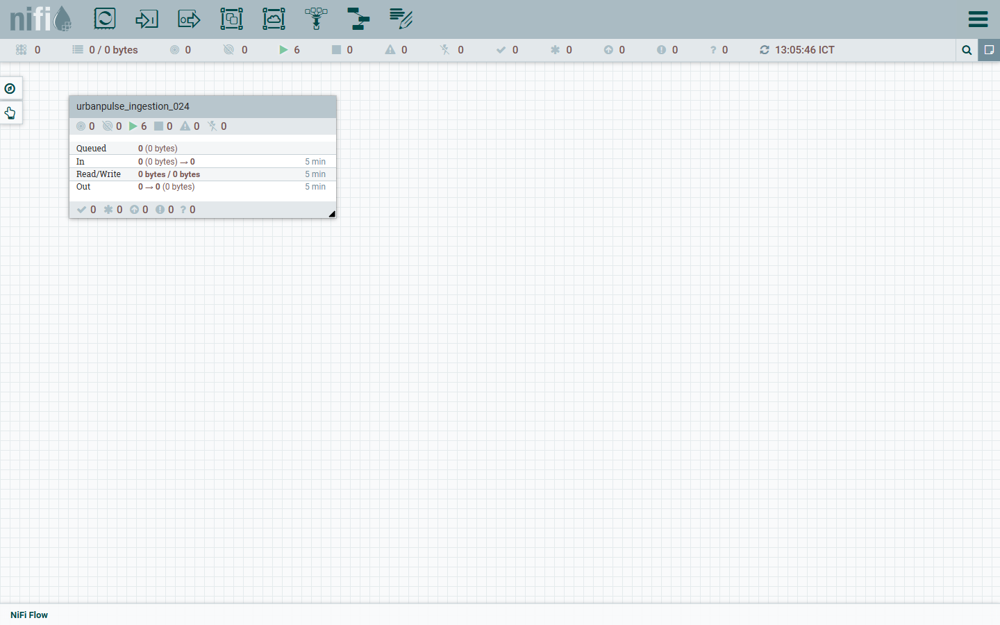
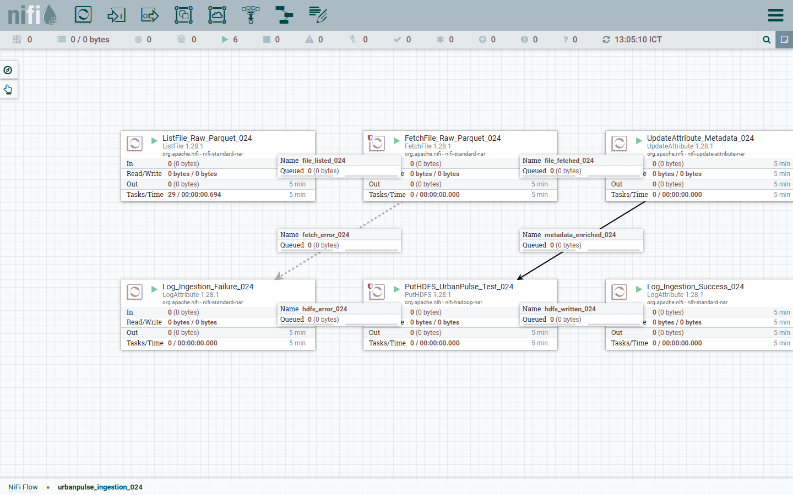
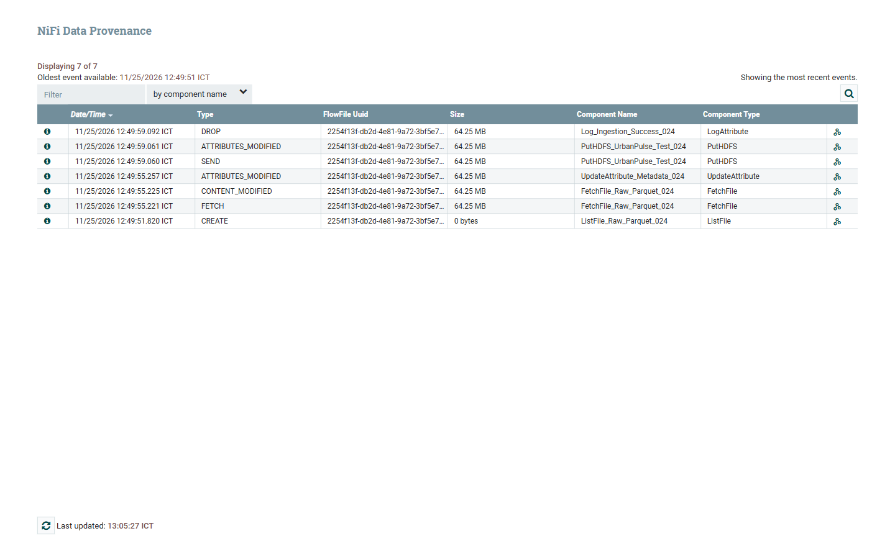
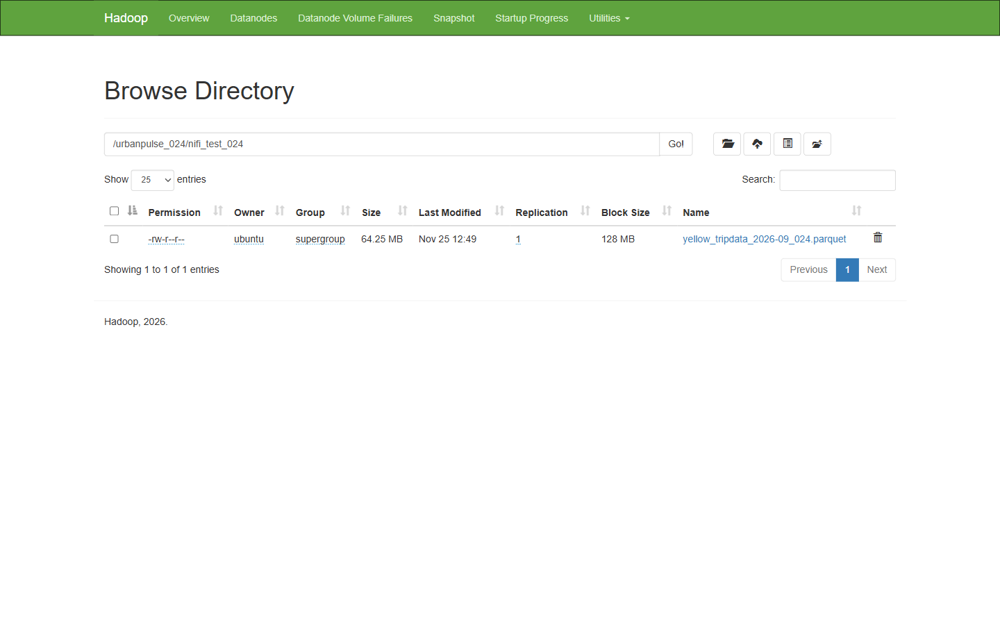

# Dokumentasi Integrasi Apache NiFi — UrbanPulse (`_024`)

> **Proyek:** UrbanPulse — Intelligent Urban Taxi Analytics  
> **Tanggal Integrasi & Pengujian:** 25 November 2026  
> **Versi Apache NiFi:** `1.28.1` (Standalone, terisolasi di user-space WSL2)  
> **Konvensi Penamaan:** Seluruh identifier buatan proyek menggunakan akhiran `_024` sesuai [naming_convention_024.md](naming_convention_024.md).

---

## 1. Peran Apache NiFi dalam Arsitektur UrbanPulse

Dalam arsitektur *Medallion* UrbanPulse (**Local Source → Apache NiFi → HDFS Raw → PySpark Silver → PySpark Gold → Spark MLlib → Streamlit Dashboard**), **Apache NiFi** berperan sebagai **lapisan ingestion otomatis (*automated data ingestion layer*)** yang memindahkan berkas dataset mentah lokal (NYC TLC Yellow Taxi Parquet) ke Hadoop Distributed File System (HDFS) secara terkelola, dapat diaudit (*Data Provenance*), dan bebas duplikasi.

```text
[Local Workspace: data/raw/yellow_tripdata_2026-09_024.parquet]
                            │
                            ▼
          ┌───────────────────────────────────────┐
          │   Apache NiFi 1.28.1 (WSL2 Standalone)│
          │   Process Group: urbanpulse_ingestion_024
          │   1. ListFile_Raw_Parquet_024         │
          │   2. FetchFile_Raw_Parquet_024        │
          │   3. UpdateAttribute_Metadata_024     │
          │   4. PutHDFS_UrbanPulse_Test_024      │
          │   5. Log_Ingestion_Success_024        │
          │   6. Log_Ingestion_Failure_024        │
          └───────────────────────────────────────┘
                            │
          ┌─────────────────┴─────────────────┐
          ▼ (Uji Terisolasi - PASS)           ▼ (Target Produksi Masa Depan)
[/urbanpulse_024/nifi_test_024/]    [/urbanpulse_024/raw/yellow_taxi/]
                                    (File Sep 2026 sudah ada sebelum
                                     integrasi NiFi; tidak ditimpa)
```

---

## 2. Analisis Kompatibilitas Lingkungan & Instalasi

### 2.1 Hasil Inspeksi Lingkungan (Phase A)

| Komponen | Kondisi Aktual | Keterangan Kompatibilitas |
| :--- | :--- | :--- |
| **Host OS** | Windows 11 Home (Intel Core i7-1355U, 16 GB RAM) | WSL2 localhost forwarding aktif |
| **WSL2 Linux** | Ubuntu 24.04.4 LTS (kernel 6.6.87.1) | RAM 7.5 GiB (5.9 GiB tersedia sebelum NiFi), disk `/` 941 GB kosong |
| **Java Runtime** | OpenJDK `17.0.20` (`/usr/lib/jvm/java-17-openjdk-amd64`) | **Kompatibel penuh dengan NiFi 1.28.1** *(NiFi 2.x membutuhkan Java 21)* |
| **Hadoop HDFS** | Apache Hadoop `3.5.0` (`/usr/local/hadoop`) | `NameNode`, `DataNode`, `SecondaryNameNode` aktif; `Safe mode is OFF` |
| **Apache Spark** | Apache Spark `4.0.4` (`/usr/local/spark`) | Tidak dijalankan selama setup & uji NiFi untuk menjaga RAM |
| **File Raw Produksi** | `/urbanpulse_024/raw/yellow_taxi/yellow_tripdata_2026-09_024.parquet` | Sudah ada sejak `2026-11-25 07:24`, ukuran `67,374,896` byte, SHA-256 identik 100% dengan sumber lokal |

### 2.2 Pemilihan Versi & Instalasi Standalone Terisolasi (Phase B)

- **Versi Dipilih:** **Apache NiFi `1.28.1`** (rilis resmi terakhir lini 1.x dari sumber resmi Apache CDN `https://dlcdn.apache.org/nifi/1.28.1/nifi-1.28.1-bin.zip`).
- **Alasan Pemilihan:** Mendukung OpenJDK 17 secara *native* tanpa perlu memasang Java 21 atau mengubah `JAVA_HOME` sistem, serta menyertakan bundel resmi `nifi-hadoop-nar` (`PutHDFS`).
- **Verifikasi Integritas Paket Unduhan:**
  - SHA-256 resmi: `f4aebc6b37587054955380b094900971dba27e86f9bc83e363764c499bc8c597` (**PASS**).
- **Lokasi Instalasi:** `/home/ubuntu/nifi-1.28.1` (user-space WSL2, **tanpa `sudo`**, terisolasi penuh dari `/usr/local/hadoop` dan `/usr/local/spark`).
- **Konfigurasi Ringan (`conf/bootstrap.conf`, `bin/nifi-env.sh`, `conf/nifi.properties`):**
  - `JAVA_HOME` khusus NiFi: `/usr/lib/jvm/java-17-openjdk-amd64`
  - Memori JVM konservatif: `-Xms512m` hingga `-Xmx1g` (sisa RAM bebas WSL saat NiFi + HDFS berjalan tetap **4.9 GiB**)
  - Endpoint UI lokal: `http://127.0.0.1:8090/nifi` (terikat khusus `127.0.0.1`, port `8090` dipilih agar tidak bentrok dengan Spark `8080/4040`, Hadoop NameNode `9870`, HDFS `9000`, maupun Streamlit `8501`)
  - Pembatasan storage internal: `nifi.provenance.repository.max.storage.size=256 MB`, `nifi.content.repository.archive.max.usage.percentage=30%`
- **Konfigurasi Hadoop:** **Tidak diubah sama sekali.** NiFi membaca `/usr/local/hadoop/etc/hadoop/core-site.xml` dan `/usr/local/hadoop/etc/hadoop/hdfs-site.xml` secara *read-only*.
- **File Referensi di Workspace:**
  - [nifi_runtime_024.properties](../nifi/configs/nifi_runtime_024.properties)
  - [hdfs_connection_024.properties](../nifi/configs/hdfs_connection_024.properties)

---

## 3. Arsitektur Flow & Konfigurasi Prosesor (`urbanpulse_ingestion_024`)

### 3.1 Alasan Desain `ListFile` + `FetchFile` Dibanding `GetFile`

Meskipun `GetFile` sering digunakan pada contoh dasar, pada kasus ingestion file lokal yang bersifat *immutable* terdapat dua risiko dengan `GetFile`:
1. Jika `Keep Source File = false` (bawaan), `GetFile` akan **menghapus** file dataset asli di `data/raw/`.
2. Jika `Keep Source File = true`, `GetFile` akan **menyerap file yang sama berulang kali** setiap siklus penjadwalan.

Oleh karena itu, flow `urbanpulse_ingestion_024` menerapkan pola standar resmi Apache NiFi **`ListFile` → `FetchFile` (`Completion Strategy = None`)**:
- `ListFile` menyimpan state timestamp di *local state provider* NiFi sehingga setiap file hanya didaftarkan **satu kali** (mencegah ingestion berulang).
- `FetchFile` dengan `Completion Strategy = None` membaca byte Parquet secara utuh **tanpa menghapus maupun memindahkan** file sumber lokal.

### 3.2 Daftar Prosesor & Konfigurasi Detail

Definisi flow lengkap diekspor ke [urbanpulse_ingestion_024.json](../nifi/flows/urbanpulse_ingestion_024.json) (Process Group ID: `113f2ad0-01a2-1000-9c06-fdc10174226b`).

| No | Nama Prosesor | Tipe Resmi NiFi (Bundle) | Pengaturan Utama | Relasi Keluar |
| :-: | :--- | :--- | :--- | :--- |
| 1 | `ListFile_Raw_Parquet_024` | `ListFile` (`nifi-standard-nar 1.28.1`) | `Input Directory`: `/mnt/d/A University/Big Data dan Analitik/Project Akhir/data/raw`<br>`File Filter`: `yellow_tripdata_2026-09_024\.parquet`<br>`Recurse Subdirectories`: `false`<br>`Listing Strategy`: `timestamps`<br>`Scheduling`: `10 sec` | `success` → `FetchFile_Raw_Parquet_024` (`file_listed_024`) |
| 2 | `FetchFile_Raw_Parquet_024` | `FetchFile` (`nifi-standard-nar 1.28.1`) | `File to Fetch`: `${absolute.path}/${filename}`<br>`Completion Strategy`: `None` *(file lokal tetap utuh)* | `success` → `UpdateAttribute_Metadata_024` (`file_fetched_024`)<br>`failure`, `not.found`, `permission.denied`, `comms.failure` → `Log_Ingestion_Failure_024` (`fetch_error_024`) |
| 3 | `UpdateAttribute_Metadata_024` | `UpdateAttribute` (`nifi-update-attribute-nar 1.28.1`) | Menambahkan atribut metadata FlowFile (tanpa menyentuh isi Parquet):<br>`urbanpulse.project_id_024=urbanpulse_024`<br>`urbanpulse.dataset_layer_024=raw`<br>`urbanpulse.source_system_024=nyc_tlc_yellow_taxi_local_parquet`<br>`urbanpulse.ingestion_tool_024=apache_nifi_1.28.1`<br>`urbanpulse.ingestion_mode_024=safe_hdfs_test_024`<br>`urbanpulse.ingested_at_024=${now():format('yyyy-MM-dd HH:mm:ss')}` | `success` → `PutHDFS_UrbanPulse_Test_024` (`metadata_enriched_024`) |
| 4 | `PutHDFS_UrbanPulse_Test_024` | `PutHDFS` (`nifi-hadoop-nar 1.28.1`) | `Hadoop Configuration Resources`: `/usr/local/hadoop/etc/hadoop/core-site.xml,/usr/local/hadoop/etc/hadoop/hdfs-site.xml`<br>`Directory`: `/urbanpulse_024/nifi_test_024`<br>`Conflict Resolution Strategy`: `ignore` *(anti-overwrite)*<br>`Compression codec`: `NONE` *(byte Parquet 100% asli)* | `success` → `Log_Ingestion_Success_024` (`hdfs_written_024`)<br>`failure` → `Log_Ingestion_Failure_024` (`hdfs_error_024`) |
| 5 | `Log_Ingestion_Success_024` | `LogAttribute` (`nifi-standard-nar 1.28.1`) | `Log Level`: `info`, `Log Payload`: `false`<br>`Log prefix`: `[URBANPULSE_NIFI_SUCCESS_024]` | `success` (*auto-terminated*) |
| 6 | `Log_Ingestion_Failure_024` | `LogAttribute` (`nifi-standard-nar 1.28.1`) | `Log Level`: `error`, `Log Payload`: `false`<br>`Log prefix`: `[URBANPULSE_NIFI_FAILURE_024]` | `success` (*auto-terminated*) |

---

## 4. Strategi Tujuan HDFS & Status File Produksi

1. **Direktori Uji Terisolasi (Dieksekusi & Diverifikasi):**
   - `/urbanpulse_024/nifi_test_024/yellow_tripdata_2026-09_024.parquet`
   - Digunakan untuk membuktikan koneksi NiFi → HDFS, integritas byte-per-byte, serta proteksi anti-duplikasi tanpa menyentuh lapisan Raw, Silver, Gold, ML, maupun Dashboard yang sudah terverifikasi.
2. **Direktori Raw Produksi (Dipertahankan Utuh):**
   - `/urbanpulse_024/raw/yellow_taxi/yellow_tripdata_2026-09_024.parquet`
   - **Status Provenance:** File ini **sudah ada sebelum integrasi NiFi** (diunggah pada `2026-11-25 07:24` saat Progress 2). Hasil perbandingan ukuran (`67,374,896` byte) dan SHA-256 (`32d8d883e3fb9c0d681f4d47b205afe0fcb2a4830739673b4dd3bafbac9b0086`) menunjukkan file produksi **100% identik** dengan file sumber lokal.
   - Sesuai aturan keselamatan proyek, file Raw produksi **tidak dihapus dan tidak ditimpa ulang**. Untuk dataset bulan baru di masa depan (misalnya `2026-10`), operator cukup mengganti properti `Directory` pada `PutHDFS` menjadi `/urbanpulse_024/raw/yellow_taxi` dan memperbarui `File Filter` pada `ListFile` (misalnya `yellow_tripdata_.*\.parquet`) dengan `Conflict Resolution Strategy = ignore`.

---

## 5. Prosedur Pengujian & Hasil Verifikasi Aktual (Phase D)

Pengujian dijalankan pada **25 November 2026, pukul 12:49 WIB (ICT)** dan dicatat otomatis dalam [ingestion_test_result_024.json](../nifi/configs/ingestion_test_result_024.json).

### 5.1 Hasil Eksekusi Flow & Anti-Duplikasi

- **Validasi Awal:** Seluruh 6 prosesor berstatus `VALID` (`0` validation errors, `0` bulletins).
- **Durasi Transfer End-to-End:** `7.27` detik pada provenance (`12:49:51.820` → `12:49:59.092 ICT`; polling API selesai dalam `8.1` detik).
- **FlowFile Provenance UUID:** `2254f13f-db2d-4e81-9a72-3bf5e7...` (`7` event berurutan: `CREATE` → `FETCH` → `CONTENT_MODIFIED` → `ATTRIBUTES_MODIFIED` → `SEND` → `ATTRIBUTES_MODIFIED` → `DROP`).
- **Uji Anti-Duplikasi:** Flow dibiarkan aktif selama >25 detik (melewati >2 siklus `ListFile` 10 detik) dan dipantau ulang 10 menit kemudian. Jumlah file di `/urbanpulse_024/nifi_test_024/` tetap **tepat 1 file** dan tidak ada FlowFile baru yang tercipta.
- **Audit Log NiFi (`logs/nifi-app.log`):** Tercatat entri `[URBANPULSE_NIFI_SUCCESS_024]` untuk keberhasilan transfer dan **0 entri** `[URBANPULSE_NIFI_FAILURE_024]`.

### 5.2 Perbandingan Ukuran & Checksum SHA-256

| Lokasi File | Status | Ukuran (Byte) | SHA-256 | Hasil |
| :--- | :--- | :---: | :--- | :---: |
| **Sumber Lokal**<br>`data/raw/yellow_tripdata_2026-09_024.parquet` | Asli & utuh (tidak terhapus) | `67,374,896` | `32d8d883e3fb9c0d681f4d47b205afe0fcb2a4830739673b4dd3bafbac9b0086` | **BASELINE** |
| **Output Uji NiFi di HDFS**<br>`/urbanpulse_024/nifi_test_024/yellow_tripdata_2026-09_024.parquet` | Ditransfer oleh NiFi (`12:49`) | `67,374,896` | `32d8d883e3fb9c0d681f4d47b205afe0fcb2a4830739673b4dd3bafbac9b0086` | **PASS (100% Identik)** |
| **Raw Produksi HDFS**<br>`/urbanpulse_024/raw/yellow_taxi/yellow_tripdata_2026-09_024.parquet` | Eksisting (`07:24`), tidak disentuh | `67,374,896` | `32d8d883e3fb9c0d681f4d47b205afe0fcb2a4830739673b4dd3bafbac9b0086` | **PASS (Utuh & Identik)** |

---

## 6. Bukti Tangkapan Layar Asli

Seluruh tangkapan layar berikut diambil langsung dari layanan aktif Apache NiFi 1.28.1 dan Hadoop 3.5.0 NameNode:

1. **Antarmuka Web UI Apache NiFi (Root Canvas):**  
     
   File: `reports/figures/nifi_01_ui_overview_024.png`
2. **Diagram Lengkap Flow Ingestion (`urbanpulse_ingestion_024`):**  
     
   File: `reports/figures/nifi_02_ingestion_flow_024.png`
3. **Bukti Eksekusi Prosesor (NiFi Data Provenance — 7 Event Sukses, 64.25 MB):**  
     
   File: `reports/figures/nifi_03_processor_execution_provenance_024.png`
4. **Verifikasi Output HDFS pada Hadoop NameNode Explorer (`/urbanpulse_024/nifi_test_024`):**  
     
   File: `reports/figures/nifi_04_hdfs_verification_024.png`

---

## 7. Operasional Harian (Start / Stop Aman)

Apache NiFi berjalan sebagai proses JVM yang **sepenuhnya independen** dari Hadoop HDFS, Apache Spark, dan Streamlit Dashboard. Menghentikan NiFi **tidak akan memengaruhi** data HDFS, proses PySpark, maupun tampilan Dashboard Streamlit.

```bash
# Mengecek status NiFi (WSL Ubuntu)
/home/ubuntu/nifi-1.28.1/bin/nifi.sh status

# Menjalankan NiFi (UI aktif di http://127.0.0.1:8090/nifi)
/home/ubuntu/nifi-1.28.1/bin/nifi.sh start

# Menghentikan NiFi dengan aman (disarankan saat akan menjalankan job Spark berat)
/home/ubuntu/nifi-1.28.1/bin/nifi.sh stop
```

---

## 8. Keterbatasan, Catatan Keamanan, & Langkah Manual Opsional

1. **Mode HTTP Lokal (`127.0.0.1:8090`):** Untuk kemudahan demonstrasi akademik lokal tanpa peringatan sertifikat *self-signed* TLS, Web UI dikonfigurasi pada HTTP khusus *loopback* `127.0.0.1`. Pada lingkungan produksi/jaringan bersama, HTTPS + autentikasi pengguna/Kerberos wajib diaktifkan kembali.
2. **Direktori Uji `/urbanpulse_024/nifi_test_024/`:** Sengaja dibiarkan tetap ada sebagai bukti hasil pengujian yang dapat diverifikasi dosen. File di dalamnya hanya menggunakan `64.25 MB` ruang HDFS (`dfs.replication=1`) dan terpisah dari jalur Raw/Silver/Gold.
3. **Langkah Manual Opsional untuk Dataset Bulan Baru:**
   - Salin file Parquet baru ke `data/raw/` (mengikuti konvensi `_024` & catat provenance di `docs/naming_convention_024.md`).
   - Di NiFi UI (`http://127.0.0.1:8090/nifi`), masuk ke `urbanpulse_ingestion_024`, hentikan prosesor sementara, ubah `PutHDFS` `Directory` ke `/urbanpulse_024/raw/yellow_taxi` (pastikan `Conflict Resolution Strategy = ignore`), sesuaikan `ListFile` `File Filter`, lalu jalankan kembali.
4. **Arsip Instalasi Lokal WSL:** File zip unduhan (`/home/ubuntu/nifi-1.28.1-bin.zip`, ~1.19 GB) masih tersimpan di home WSL; dapat dihapus secara manual jika ingin menghemat ruang disk, karena ekstraksi sudah berada di `/home/ubuntu/nifi-1.28.1`.
